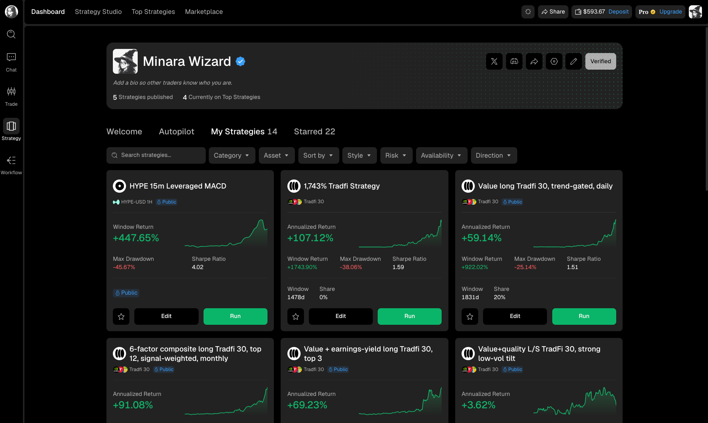

# Manage your strategies

Your profile is the control center for strategies you have created and published. Use it to find a strategy, update its public listing, manage who can subscribe, review subscriber and profit-share information, or return to Strategy Studio to change the strategy itself.

<figure><figcaption></figcaption></figure>

## Start from your profile

Open your profile and select `My Strategies`. This tab contains every strategy attached to your account, including both public and non-public strategies. The number beside the tab is the total in the current library.

The management flow has three parts:

1. [Find, review, and edit a strategy](your-strategy-library.md) in My Strategies, including its name, description, style, risk profile, and displayed backtest.
2. [Manage visibility and subscriptions](visibility-subscribers-and-earnings.md), then open the owner view for subscriber information and available profit-share data.
3. [Update your creator profile](edit-your-creator-profile.md) so traders can understand who published the strategy.

## Choose the correct edit path

Publication settings and strategy logic are edited in different places.

| What you want to change                                                         | Where to change it                    |
| ------------------------------------------------------------------------------- | ------------------------------------- |
| Strategy name, description, style, risk profile, or public backtest             | `Edit` on the published strategy page |
| Public, subscribable, profit-share rate, investment limits, or subscriber limit | `Edit` → `Visibility`                 |
| Trading logic, parameters, asset or universe, and strategy code                 | `Edit in Strategy Studio`             |
| Banner, avatar, display name, bio, website, or social links                     | Profile pencil → `Edit Profile`       |

Changing a Marketplace listing does not rewrite the strategy logic. Use Strategy Studio when the trading rules need to change.
