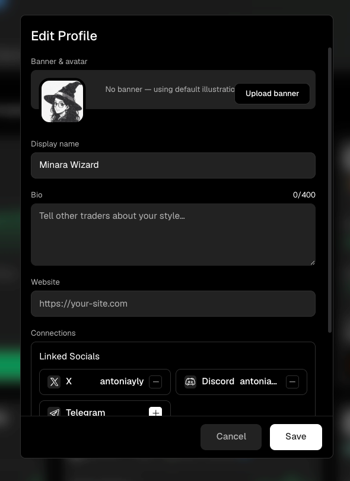

# Edit your creator profile

Your creator profile appears beside the strategies you publish. Keep it specific enough that prospective Subscribers can identify you, understand your approach, and find the public channels you choose to share.



Open your profile and select the pencil button in the header. The `Edit Profile` dialog contains the public identity fields.

<figure><figcaption></figcaption></figure>

## Profile fields

| Field             | What appears publicly                                                       |
| ----------------- | --------------------------------------------------------------------------- |
| Banner and avatar | The visual identity shown in your profile header and creator references.    |
| Display name      | The name attached to your creator profile and published strategies.         |
| Bio               | A short description of your trading approach or the strategies you publish. |
| Website           | A public site where users can learn more about you.                         |
| Linked socials    | Connected X, Discord, Telegram, or other supported accounts.                |

Only connect channels you want visitors to use. Review the profile as a public visitor after saving, especially after changing a display name, website, or social connection.

## What the profile summary shows

The profile header also reports how many strategies you have published and how many are currently on Top Strategies. Social links, follow controls, and verification status appear here when available.

These profile-level statistics are different from strategy-level subscriber and profit-share data. Open the relevant strategy's `Subscriber Overview` when you need publication-specific information.
