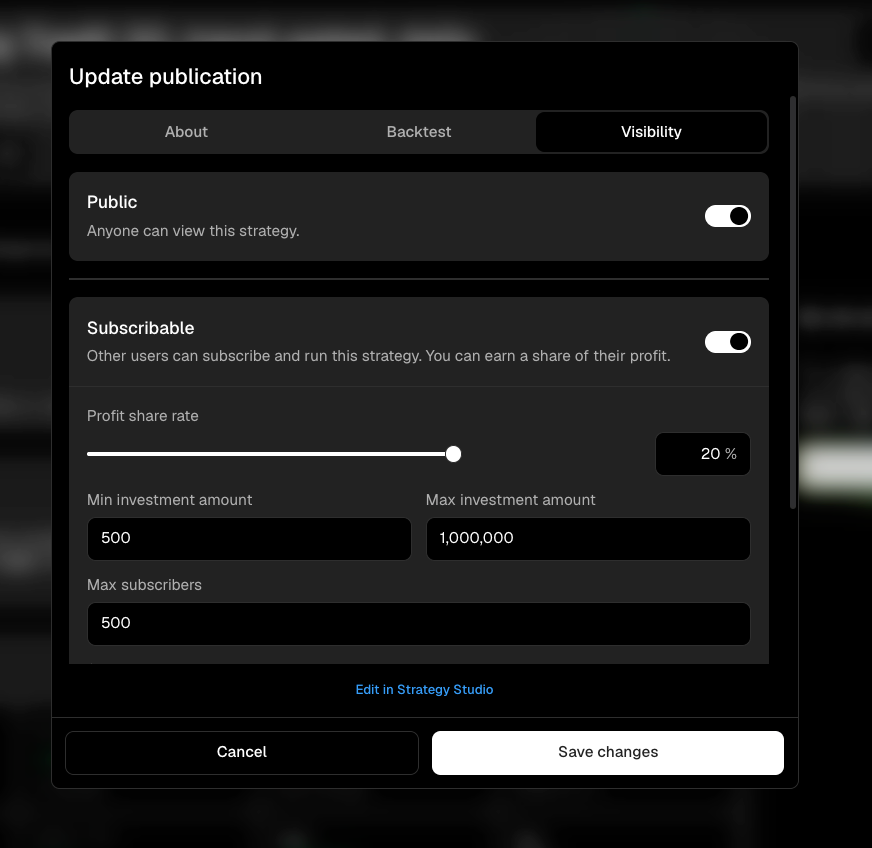
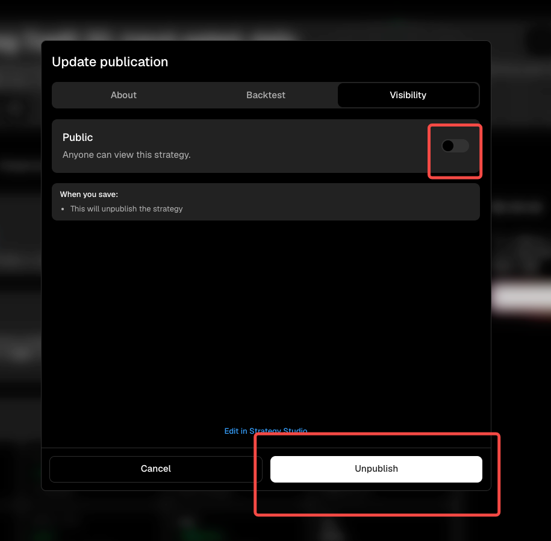

# Visibility, subscribers, and earnings

The `Visibility` tab controls whether other users can find a strategy and whether they can subscribe to run it. It also sets the commercial limits for the publication.

<figure><figcaption></figcaption></figure>

## Public and subscribable

`Public` makes the strategy visible to other users. Turn on `Subscribable` when users should be able to become Subscribers and run it. A public strategy can remain viewable without accepting subscriptions.

When subscriptions are enabled, review each limit before saving:

| Setting                   | What it controls                                                                                                |
| ------------------------- | --------------------------------------------------------------------------------------------------------------- |
| Profit share rate         | The percentage of a Subscriber's strategy profit allocated to the creator.                                      |
| Minimum investment amount | The smallest allocation accepted from one Subscriber. It cannot be lower than the platform minimum of **$500**. |
| Maximum investment amount | The largest allocation accepted from one Subscriber.                                                            |
| Maximum Subscribers       | The total number of Subscribers the publication can accept.                                                     |

Choose limits that match the strategy's intended capacity and risk. You may set the minimum investment above **$500**, but not below it. Select `Save changes` when the visibility and subscription terms are correct.

## Review subscribers and profit share

Return to the published strategy page and open `Subscriber Overview`. This opens the owner view for that publication's subscriber information. Review any available profit-share data there before changing the profit-share rate, investment limits, or subscriber cap.

Subscriber data belongs to a specific publication. Check that you opened the correct strategy when you manage several public strategies.

## Unpublish a strategy

To remove a strategy from public discovery, open `Visibility` and turn off `Public`. The editor explains that saving will unpublish the strategy, and the primary action changes to `Unpublish`.

<figure><figcaption></figcaption></figure>

Review `Subscriber Overview` before confirming so you understand the strategy's current subscription state. Review your own live runs separately from the publication settings.
