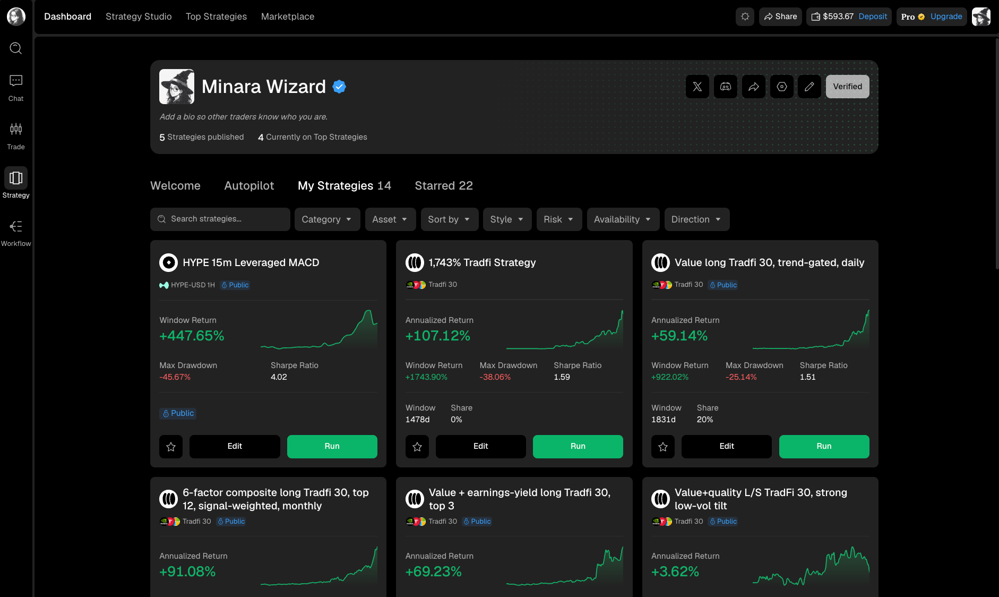
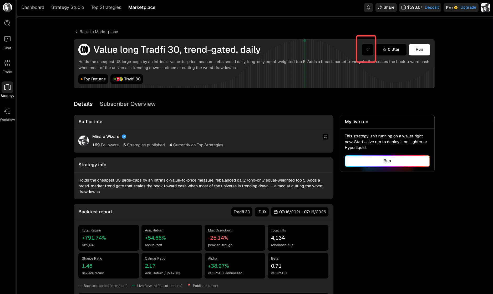
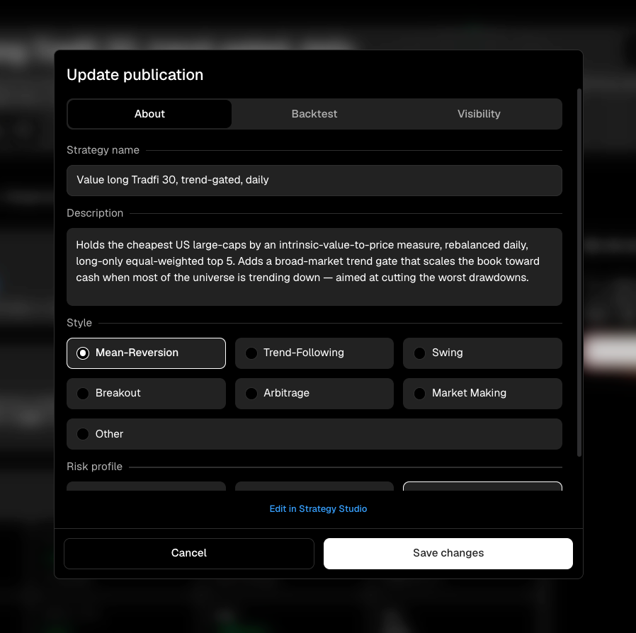

# Your strategy library

`My Strategies` gives you one place to find, compare, and open the strategies you created. Start here before editing a publication or returning to Strategy Studio.



<figure><figcaption></figcaption></figure>

## Find a strategy

Use search when you know the strategy name. The filters narrow a larger library by category, asset, style, risk, availability, or direction, while `Sort by` changes the order of the results.

Each card combines identity, performance, and management information:

| Card area      | What it tells you                                                                             |
| -------------- | --------------------------------------------------------------------------------------------- |
| Header         | Strategy name, asset or universe, timeframe, and publication state.                           |
| Return chart   | How the selected performance window developed over time.                                      |
| Metrics        | Return, maximum drawdown, Sharpe ratio, window length, and share where applicable.            |
| `Public` label | The strategy is visible to other users. A strategy without the label is not currently public. |

Use the star to save the strategy to `Starred`. `Run` starts the flow for running it with your own wallet. `Edit` opens the owner view for publication settings.

## Open the owner view

Select `Edit` on a strategy card, or open the strategy detail page and use the pencil button. The owner view adds controls that other visitors do not see.

<figure><figcaption></figcaption></figure>

The strategy page separates two jobs:

* `Details` shows the public strategy information and backtest report.
* `Subscriber Overview` opens the owner view for that publication's subscriber information.

The `Run` control is separate from publication management. Publishing a strategy lets other users discover it; running it allocates one of your own wallets.

## Edit the published listing

Use the publication editor when the strategy is correct but its Marketplace presentation needs to change. From the owner view, select the pencil button and start in the `About` tab.

<figure><figcaption></figcaption></figure>

The `About` tab controls how the strategy is described and classified.

| Field         | How to use it                                                                                                                                                             |
| ------------- | ------------------------------------------------------------------------------------------------------------------------------------------------------------------------- |
| Strategy name | Keep it specific enough to distinguish the strategy from your other publications.                                                                                         |
| Description   | Explain what it trades, the main signal or factor, the rebalance or entry cadence, and the intended risk behavior.                                                        |
| Style         | Choose the closest behavior, such as mean reversion, trend following, swing, breakout, arbitrage, or market making. Use `Other` only when none of the listed styles fits. |
| Risk profile  | Set the risk category that matches the published strategy and its backtest.                                                                                               |

Open the `Backtest` tab to review the backtest attached to the publication. Select `Save changes` after reviewing every tab you changed.

## Change the strategy itself

Publication fields do not change the trading rules. Select `Edit in Strategy Studio` when you need to change the code, indicators, parameters, asset or universe, timeframe, or execution rules.

Run a new backtest after changing strategy logic. Before updating the publication, return to the editor and review both the `About` and `Backtest` tabs.


Make sure the public description matches the strategy version and backtest that visitors can inspect. A listing that describes old logic is difficult for prospective Subscribers to evaluate.

