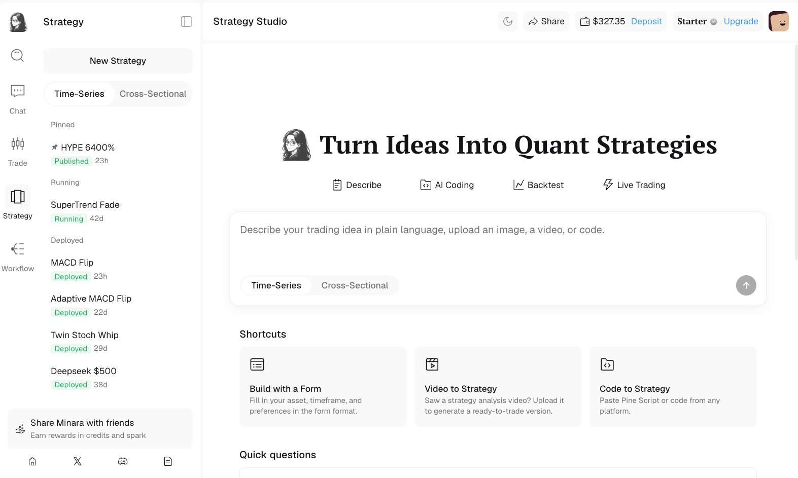

# What Strategy Studio is

[Strategy Studio](https://minara.ai/app/strategy-studio) covers the full path from idea to live trading: describe a strategy, test it against historical data, watch it trade in a paper account, then deploy it with real capital. A strategy stays editable as a draft until you deploy, so nothing trades until you decide it should.



<figure><figcaption></figcaption></figure>

Every strategy follows the same four stages:

1. Describe. Set up the idea in plain language or by selecting its components.
2. AI coding. Minara generates readable code for the strategy.
3. Backtest. Test it against historical data and read the results.
4. Go live. Paper trade it, then deploy it to trade automatically.

## What you can do

| Capability                  | What it means                                                                               |
| --------------------------- | ------------------------------------------------------------------------------------------- |
| Generate from language      | Describe a strategy in plain language and Minara builds it. Minara calls this Vibe Trading. |
| Refine in chat              | Read what Minara generated and adjust it through more chat, without writing code by hand.   |
| Backtest on historical data | Run your strategy against past market data and read a full performance report.              |
| Validate in paper           | Run live against current prices with no real capital before committing funds.               |
| Optimize                    | Ask Minara to tune the settings and report which performed best.                            |
| Deploy and monitor          | Put a strategy live in Autopilot and track its APY, positions, and trades.                  |

## Two modes

Strategy Studio builds two kinds of strategies. Use the toggle above the prompt box to choose the one that matches your idea.

[Time-series](https://minara.ai/app/strategy-studio) trades one asset by watching its own price over time. It reacts to signals on that asset's chart, such as RSI crossing a level, an EMA crossover, or a breakout, and decides when to go long, go short, or stay flat. Use it when your idea is about the timing of a single market, such as "short RKLB when RSI is above 70".

[Cross-sectional](https://minara.ai/app/xstrategy) trades a basket of assets at once. It scores every asset in a universe by one or more factors, ranks them, then holds the top-ranked and shorts the bottom-ranked, rebalancing on a schedule. Use it when your idea is about which assets to hold rather than when, such as "hold the 10 cheapest, highest-quality names in the TradFi 30 and short the 10 worst".

|                | Time-series                        | Cross-sectional                      |
| -------------- | ---------------------------------- | ------------------------------------ |
| Trades         | One asset                          | A universe of assets                 |
| Decides        | When to enter and exit             | Which assets to hold, long and short |
| Built from     | Price signals (RSI, EMA, breakout) | Factors ranked across the universe   |
| Typical output | Entries and exits on one chart     | A ranked long/short portfolio        |

If you are new, start with a time-series strategy, since a signal for one asset is easier to reason about. Move to cross-sectional once you want to rank and trade a basket.

## Two paths through Academy

Academy separates the product into two tracks:

* The Strategy Subscribers section covers account setup, the Marketplace, Top Strategies, subscribing to a published strategy, and monitoring it in Autopilot.
* Strategy creators covers the existing time-series and cross-sectional tracks from first draft through backtesting, optimization, deployment, and publishing.

## Who it's for

* New to algorithmic trading: describe an idea in plain language and get a working strategy without writing any code.
* Active traders: turn a setup you already trade by hand into a strategy that runs around the clock.
* Quantitative traders: combine factors across a universe and tune the mix.
* Subscribers: compare published strategies, subscribe, and run one without building its rules yourself.
