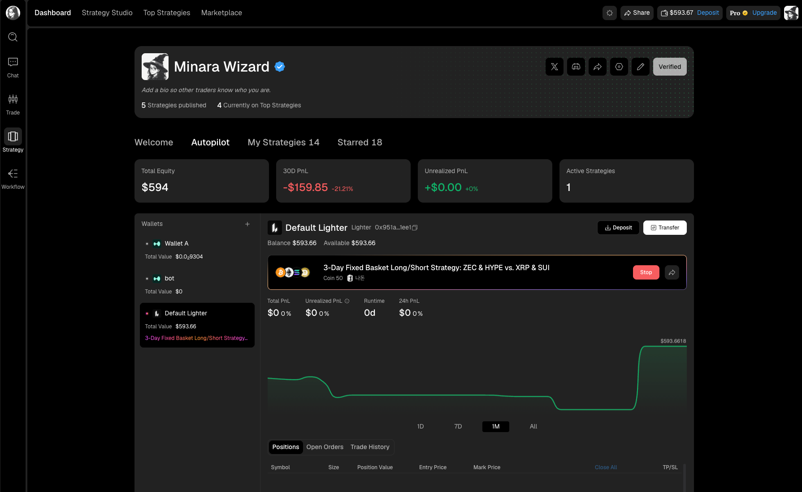
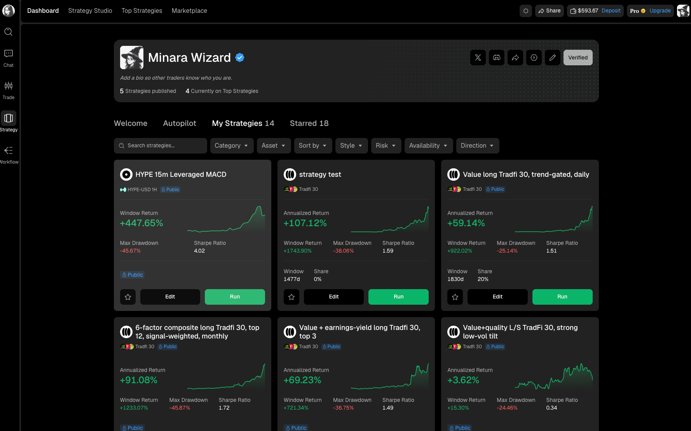
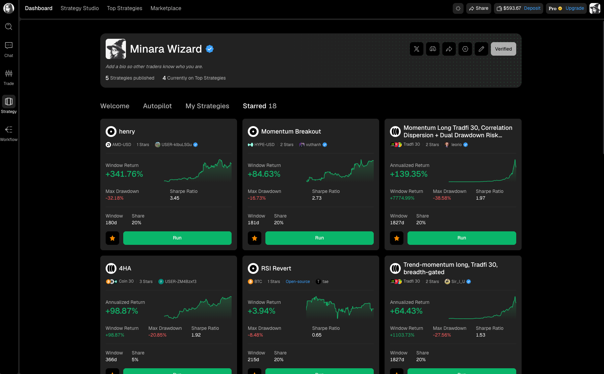

# Autopilot explained

Autopilot is the account view for strategies you are running. It connects each live run to a perps wallet and shows the wallet's equity, PnL, active strategy, positions, orders, and trade history in one place.



<figure><figcaption></figcaption></figure>

## Account summary

The cards at the top report four account measurements:

| Card              | What it shows                                                       |
| ----------------- | ------------------------------------------------------------------- |
| Total Equity      | Current combined equity for the selected account view.              |
| 30D PnL           | Profit or loss over the last 30 days, shown in dollars and percent. |
| Unrealized PnL    | Profit or loss on positions that are still open.                    |
| Active Strategies | Number of strategies currently running.                             |

## Wallets and routing

The left column lists your wallets and their current value. Select a wallet to see the strategy, balance, chart, and positions tied to that wallet.

The wallet header identifies the venue, such as Lighter, and shows the balance and available funds. Use `Deposit` to add funds or `Transfer` to move funds between supported wallets. A strategy runs through the venue attached to its selected wallet.

Autopilot requires at least **$500** in available funds to start. This minimum applies to strategies you created and to published strategies you subscribe to through Strategy Market. An individual published strategy may require more than **$500** if its creator set a higher minimum.

## Active strategy

The active strategy card shows its name, universe or asset, total PnL, unrealized PnL, runtime, and 24-hour PnL. Use the share icon to open or share the strategy. Use `Stop` when you intend to end the run and close its positions.

The equity chart shows how the wallet changed over the selected period. Switch between `1D`, `7D`, `1M`, and `All` to change the window. A flat chart can mean no open exposure, while a sudden change may come from a trade, transfer, deposit, or withdrawal. Check the records below before attributing a move to strategy performance.

## Positions, orders, and history

Use the tabs below the chart to inspect the account:

* `Positions` shows current exposure, size, position value, entry price, mark price, and take-profit or stop-loss controls where available.
* `Open Orders` shows orders the strategy has submitted that are not yet fully filled or cancelled.
* `Trade History` shows completed executions for the selected wallet.

Use `Close All` only when you intend to close every open position shown for that wallet.

## The other profile tabs

Your strategy profile also contains Welcome, My Strategies, and Starred.

### Welcome

Welcome separates common tasks for Subscribers and strategy creators. Subscribers can jump to strategy discovery, Top Strategies, and tutorials from here.

### My Strategies

My Strategies contains strategies you created. Each card shows its current performance and includes controls to edit, star, or run it. A `Public` label marks a published strategy.

See [Manage your strategies](../manage-your-strategies/) for publication settings, subscriber data, profit sharing, and creator profile controls.

<figure><figcaption></figcaption></figure>

### Starred

Starred contains strategies you saved from Marketplace, Top Strategies, or creator profiles. It is a watchlist, not a record of active allocations.

<figure><figcaption></figcaption></figure>

## What to monitor

Check the live run against the risk you accepted before starting it. Drawdown, open exposure, unrealized PnL, and the difference between the backtest and live forward record matter more than a single daily return. If the strategy no longer fits your risk limit, review its positions before stopping it.
