# Explore the market

Minara gives prospective Subscribers two discovery views. Top Strategies compares published strategies on one ranking screen, while Marketplace gives you search and filters for narrowing the full catalog.



## Top Strategies

Open `Top Strategies` from the top navigation when you want to compare leaders before opening individual strategy pages.

<figure>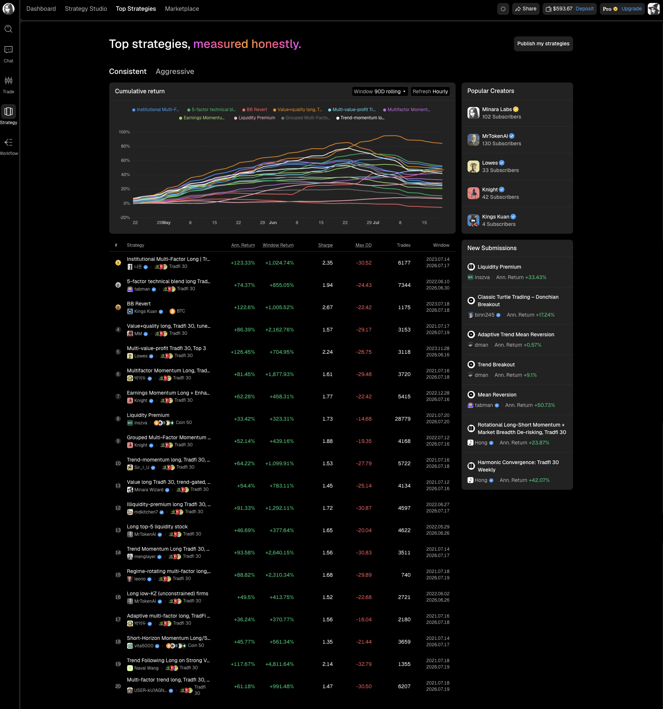<figcaption></figcaption></figure>

The page has two ranking views:

* `Consistent` favors strategies with steadier performance.
* `Aggressive` surfaces strategies that take more risk in pursuit of higher returns.

The cumulative return chart compares the strategies over a rolling window. The table below shows annualized return, window return, Sharpe ratio, maximum drawdown, trade count, and the measurement window. Use the chart to see how returns developed, then use the table to compare return with drawdown and Sharpe. A high return by itself does not tell you how much risk the strategy took.

The right column lists popular creators and new submissions. Select a creator to open their public profile, or select a strategy to review its details.

## Marketplace

Open `Marketplace` when you already know the kind of strategy, asset, risk level, or creator you want.

<figure>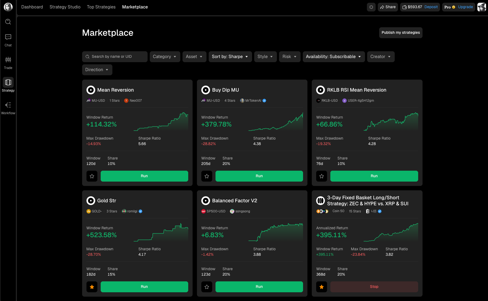<figcaption></figcaption></figure>

Each strategy card shows the strategy name and market, creator, return for the displayed window, maximum drawdown, Sharpe ratio, window length, and the share used by the strategy. The small chart shows how the displayed return changed during that window.

Use the star button to save a strategy to your profile. Click `Run` when you are ready to open the strategy and start the allocation flow.

## Search and filters

Search accepts a strategy name or UID. You can combine filters, starting broad and adding constraints until the list is manageable.

| Filter       | Available choices                                                                 | How to use it                                                              |
| ------------ | --------------------------------------------------------------------------------- | -------------------------------------------------------------------------- |
| Category     | All, Time-Series, Cross-Sectional                                                 | Choose whether the strategy trades one market over time or ranks a basket. |
| Asset        | Asset groups such as TradFi 30, Coin 30, Coin 50, plus individual markets         | Restrict results to a universe or one asset.                               |
| Sort by      | Featured, APY, Sharpe, Calmar, Max DD                                             | Choose which measurement orders the results.                               |
| Style        | Trend following, Swing, Mean reversion, Breakout, Arbitrage, Market making, Other | Match the strategy to the trading behavior you want.                       |
| Risk         | Conservative, Balanced, Aggressive                                                | Narrow results by the creator's risk classification.                       |
| Availability | All, Subscribable, Open source                                                    | Separate strategies you can run from strategies whose code is public.      |
| Creator      | All, Verified                                                                     | Limit results to verified creators when needed.                            |
| Direction    | Available direction choices                                                       | Filter strategies by the side or exposure they trade.                      |

<figure>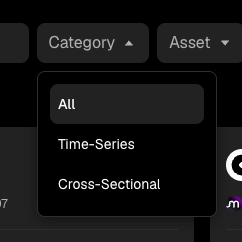<figcaption>
Category
</figcaption></figure>



<figure>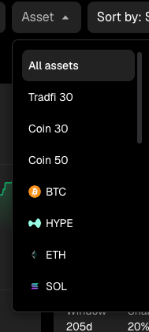<figcaption>
Asset
</figcaption></figure>



<figure>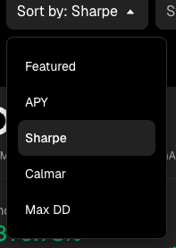<figcaption>
Sort by
</figcaption></figure>





<figure>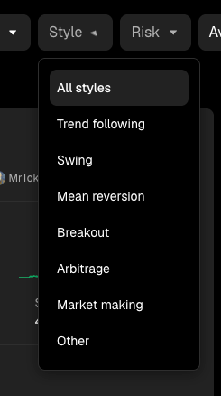<figcaption>
Style
</figcaption></figure>



<figure>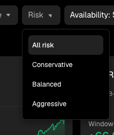<figcaption>
Risk
</figcaption></figure>





<figure>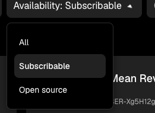<figcaption>
Availability
</figcaption></figure>



<figure>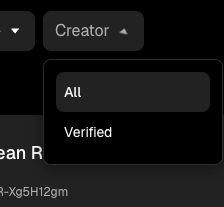<figcaption>
Creator
</figcaption></figure>



## Read a strategy page

Select a strategy card to open its detail page. Read this page before allocating funds.

<figure>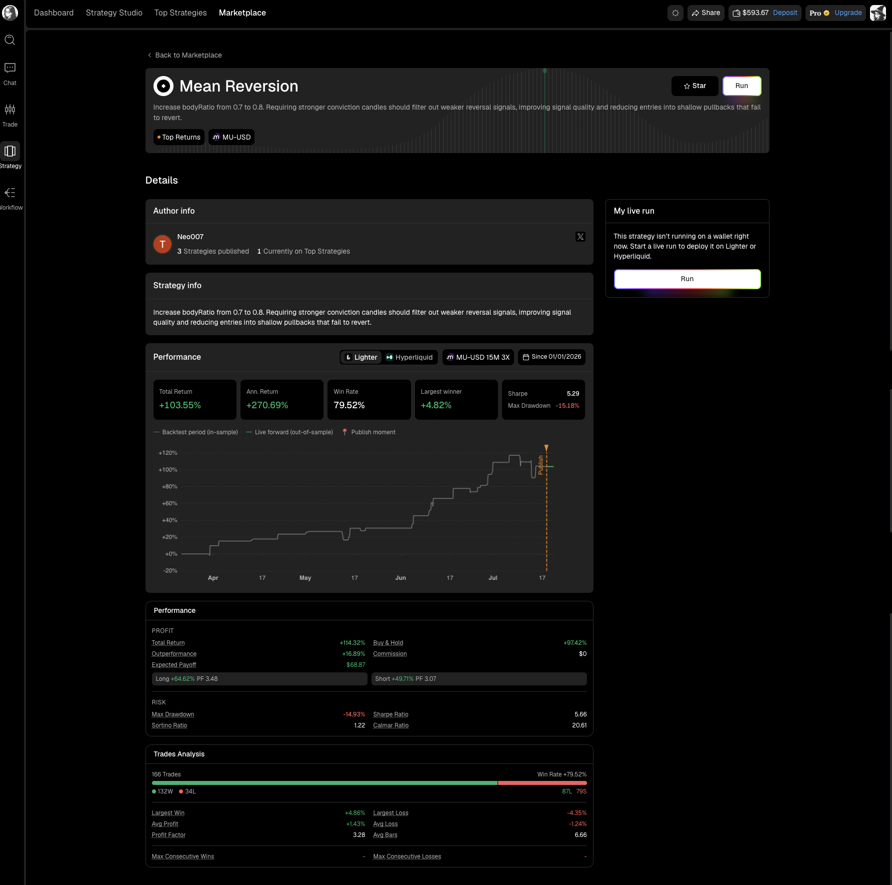<figcaption></figcaption></figure>

The page separates the information into several parts:

| Section              | What to check                                                                                                   |
| -------------------- | --------------------------------------------------------------------------------------------------------------- |
| Author info          | Who published the strategy, how many strategies they have published, and whether they appear on Top Strategies. |
| Strategy info        | The creator's description of the rules or the change being tested.                                              |
| Performance summary  | Total return, annualized return, win rate, largest winner, Sharpe ratio, and maximum drawdown.                  |
| Performance chart    | The in-sample backtest, live forward record, and the moment the strategy was published.                         |
| Detailed performance | Profit, expected payoff, commission, long and short results, drawdown, Sharpe, Sortino, and Calmar.             |
| Trades analysis      | Trade count, long and short split, win rate, average profit and loss, profit factor, and streaks.               |
| My live run          | Whether you are already running the strategy and the control for starting it.                                   |

Pay particular attention to the line change at the publish marker. Backtest data describes how the rules behaved on historical data. The live forward segment shows what happened after publication. The two answer different questions and should not be treated as one continuous live record.


Returns, Sharpe ratios, and rankings describe past results. Check drawdown, window length, trade count, fees, and the live forward record before allocating funds.


## Check the creator

Select the creator from a strategy page or card to open their public profile. The profile shows how many strategies they have published, how many are currently on Top Strategies, their social links, and the strategies available to run.

<figure>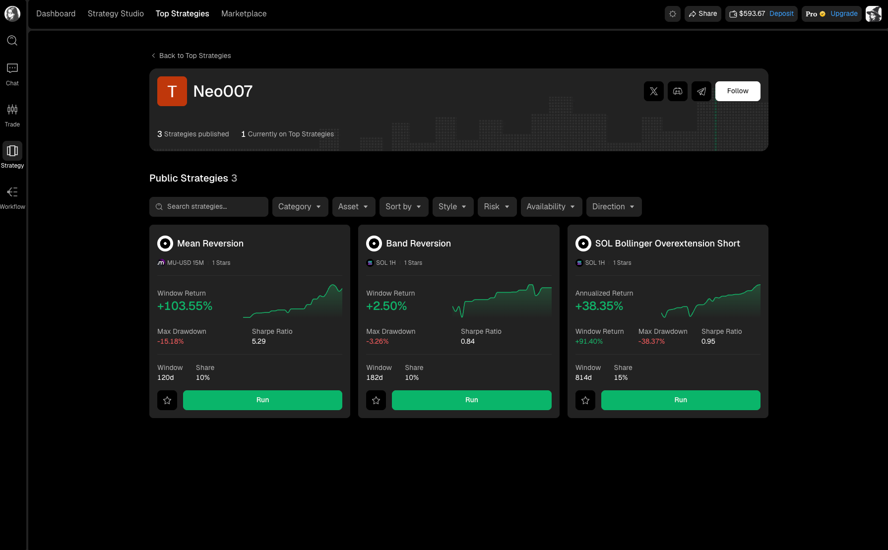<figcaption></figcaption></figure>

Verification identifies a recognized creator profile. It does not remove trading risk, so review each strategy on its own record.
