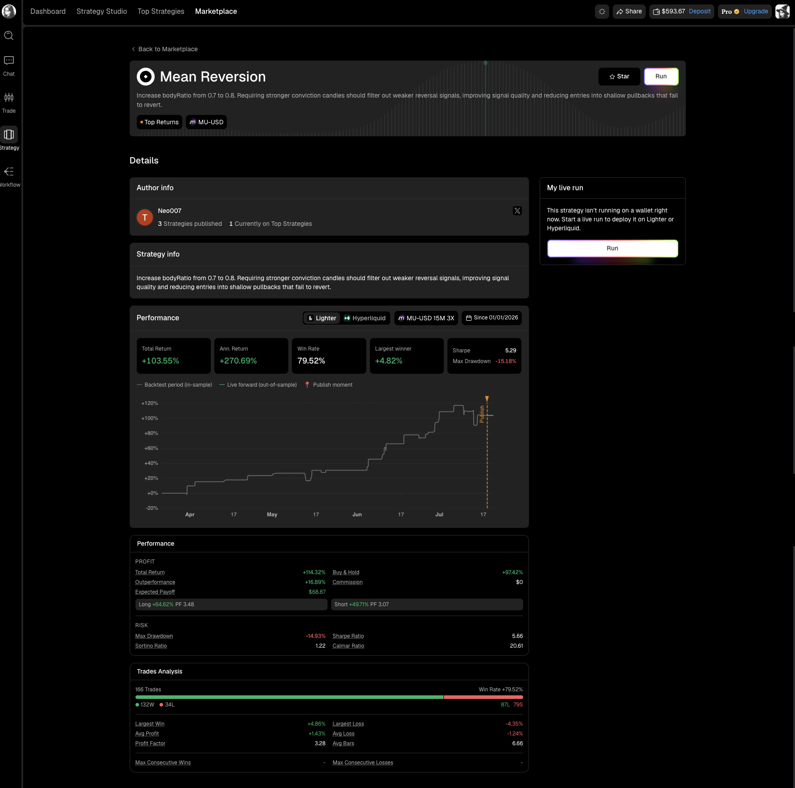
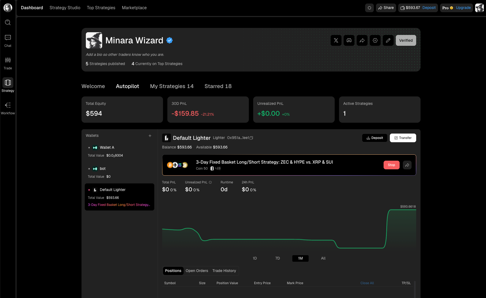
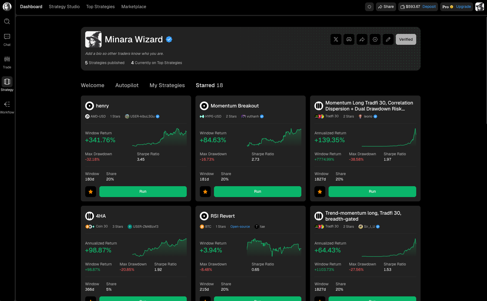

# Run your first strategy

Run a published strategy only after you have reviewed its rules, performance window, live forward record, drawdown, and creator. The `Run` button opens the allocation flow for one of your funded perps wallets.



## 1. Choose a strategy

Start from Top Strategies, Marketplace, a creator profile, or your Starred tab. Select the strategy card to open the detail page rather than relying on the card's headline return.

<figure><figcaption></figcaption></figure>

## 2. Review the record

Before clicking `Run`, check:

1. The market or universe the strategy trades.
2. Whether it is time-series or cross-sectional.
3. The backtest window and number of trades.
4. Maximum drawdown alongside total or annualized return.
5. Sharpe, Sortino, and Calmar ratios where available.
6. The live forward segment after the publish marker.
7. The creator's description and public profile.

The card's `Share` value describes the strategy's allocation setting. It is not the same as your wallet balance or your eventual profit.

## 3. Start the run

Click `Run` from the strategy header or the `My live run` panel. In the allocation flow, select the funded wallet you want to use and review the amount and strategy settings shown before confirming.

A Subscriber must allocate at least **$500** to run a published strategy. A creator may set a higher minimum for an individual strategy, so use the amount shown in the allocation flow.

If the strategy supports more than one venue, your wallet determines whether the live run uses Lighter or Hyperliquid. The strategy appears in your Autopilot tab after it starts.


A backtest is not a live guarantee. Fees, execution, liquidity, market regime changes, and the selected allocation can all change the result.


## 4. Confirm it is running

Open your profile and select `Autopilot`. The active strategy appears under the selected wallet with its current runtime, PnL, positions, orders, and trade history.

<figure><figcaption></figcaption></figure>

## Save a strategy for later

Click the star icon on a strategy card if you want to review it later without starting it. Open your profile and select `Starred` to see everything you saved.

<figure><figcaption></figcaption></figure>

## Stop a strategy

Use `Stop` from the active strategy card in Autopilot when you want the run to end. Stopping a deployed strategy closes the positions it holds. Review open positions before you stop it.
