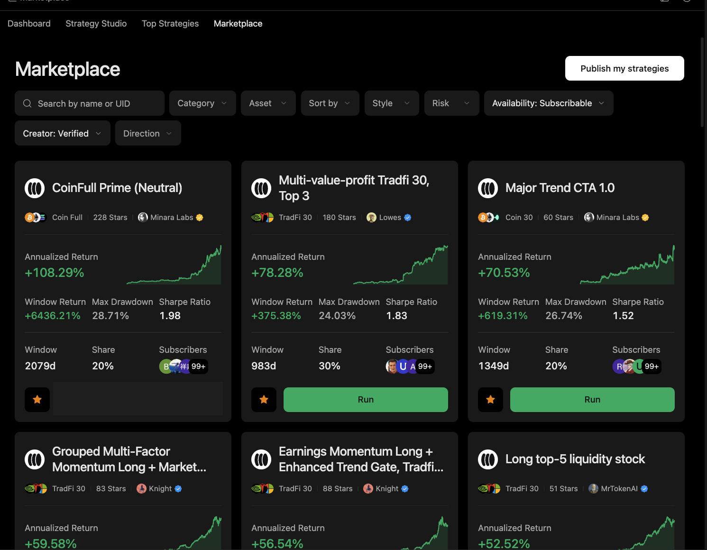

# Capability Map

This map shows how the main Harness concepts fit together.

| Capability        | What it controls                                            | Read next                                                                 |
| ----------------- | ----------------------------------------------------------- | ------------------------------------------------------------------------- |
| Session workspace | Task files, artifacts, and execution context                | [Session Workspace](../core-concepts/session-workspace.md)                |
| Context and tools | What the model sees and which tools it can request          | [Context and Tools](../core-concepts/context-and-tools.md)                |
| Memory            | Retrieved preferences, lessons, and prior reasoning         | [Memory and Learning](../core-concepts/memory-and-learning.md)            |
| Financial gates   | Preview, consent, execution, and outcome boundaries         | [Financial Authorization](../operate-safely/financial-authorization.md)   |
| Files and secrets | File mutation, credential disclosure, and runtime limits    | [Files, Secrets, Execution](../operate-safely/files-secrets-execution.md) |
| Market tools      | Data sources, asset identity, and quote interpretation      | [Market Tools](market-tools.md)                                           |
| Automation        | Hooks, scheduled workflows, and delegated subtasks          | [Hooks, Cron, Delegation](hooks-cron-delegation.md)                       |
| Coding            | Scripts, implementation changes, and verification artifacts | [Coding Workflows](coding-workflows.md)                                   |

## How to use the map

Start with the user's task. If the task asks for research, begin with context, tools, and market data. If it asks for a possible action, add financial authorization and human review. If it touches files, credentials, code, or desktop control, add the workspace and execution boundaries.

The capabilities are independent on purpose. Access to one layer should not imply access to another.
