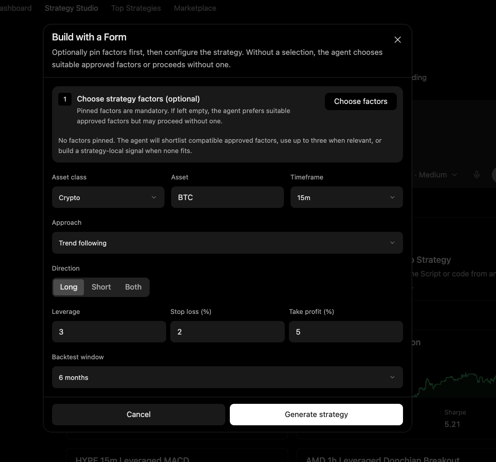

# Coding Workflows

Coding extends Minara from discussion to executable work. The agent can inspect projects, write analysis scripts, change implementations, and check results.

## Compose

Code can combine available data, tool results, and calculations into a task-specific workflow.

Some tasks need more than a market lookup or a written answer. Code can transform data, explore a hypothesis, automate a repeatable analysis, or turn an idea into a reusable script.

When no single tool answers the question, code can join inputs and calculations without requiring a dedicated product tool for every analysis.

## Iterate

The agent should run relevant checks where the environment allows and inspect the results before handoff.

Coding starts with understanding the existing project and the user's request. Relevant files, instructions, and prior work guide the change. Unrelated edits should be preserved.

The workspace provides continuity for code and artifacts, while the session transcript supports review. Specialized capabilities can be loaded as needed rather than keeping every tool definition in context.

## Reuse

Useful scripts and artifacts should stay available in the workspace for review and future work.

The handoff should say what changed, what was checked, and what remains uncertain. A proposed solution, an executed command, and a verified result are different stages of work.

## Controlled execution

Access to a shell or generated code does not grant authority to trade, move funds, publish externally, or reveal credentials. Coding supports financial workflows while keeping analysis, execution, and authorization distinct.
