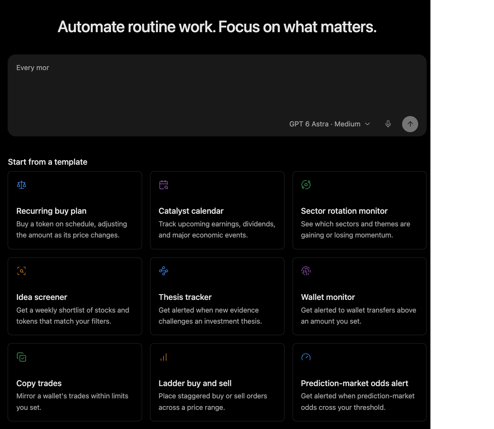

# Hooks, Cron, Delegation

Automation lets Minara run bounded work beyond a single immediate chat turn. It should stay observable, scoped, and quiet until something actionable changes.

## Hooks

Hooks can run checks around tool use, session start, compaction, or output delivery.

They are useful for enforcement, formatting, notification, and operational guardrails. A hook should have a narrow job. It should not become an invisible second agent that changes the task's meaning.

## Scheduled workflows

Recurring research, thesis trackers, and market digests should define the subject, sources, schedule, output, and notification rule.

Good scheduled workflows are specific. They say what to check, how often to check it, which sources to use, and when to notify. A workflow that fires every run without new information becomes noise.

Scheduled research is not unattended trading. If a monitored condition suggests an action, the workflow should surface the evidence and stop at the review boundary.

## Delegation

Bounded subtasks can be delegated while the main session keeps final review, user-facing judgment, and authorization boundaries.

Delegation works best for separable work: collecting sources, comparing documents, running analysis, or checking implementation details. It is weaker for final product judgment, sensitive UI decisions, or anything that needs the user's latest intent.

## Failure and recovery

Automated work should report the actual state. If a connector is missing, a source is unavailable, or a run fails, the answer should say that directly instead of filling the gap with guesses.
