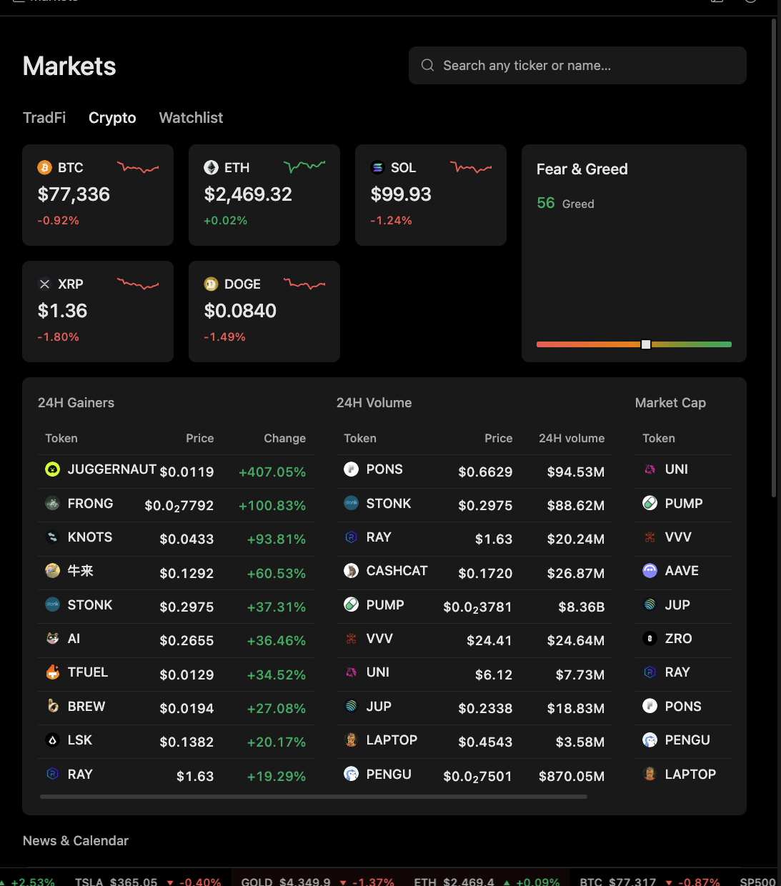

# Market Tools

Market tools connect Minara to asset pages, quotes, leaderboards, portfolio views, strategy pages, research workflows, and execution previews.

## Multi-source access

Different providers can disagree because they cover different venues, windows, or price types. A fallback result restores availability; it does not make the value semantically identical.

Minara can expose tools for market modules, quotes, news, macro information, account history, portfolio scope, strategy pages, and execution previews. The exact set depends on deployment and connected services.

Connecting several sources broadens coverage. It does not automatically establish agreement or accuracy. Cross-checking is a deliberate workflow.

## Asset identity

A ticker alone can be ambiguous. Asset class, venue, chain, contract address, execution symbol, and quote basis can matter.

Price basis matters too. A spot reference, midpoint, derivative mark price, and executable quote answer different questions. Research prices should not be presented as guaranteed execution prices.

## Freshness and provenance

A tool response may be fresh, cached, delayed, or assembled from a provider that does not expose all provenance fields. Source labels help, but they may describe configured integrations rather than the origin of each value.

When freshness or provenance matters, the agent should use available metadata and state gaps explicitly.

## Incomplete data

Unavailable modules, provider errors, and incomplete results are not neutral signals. Missing data is not a zero price and not evidence that no event occurred.

If suitable tools are available, the agent can query another source or inspect a more specific instrument. That is a recovery step, not a guarantee that every gap has a fallback.

## Research and execution

Research tools do not authorize trading. Before action, Minara needs the correct instrument, action parameters, authorization, and execution-time checks.

Historical cards and previous tool results are records of what was returned then. They should not be assumed to refresh into current observations when reopened.
