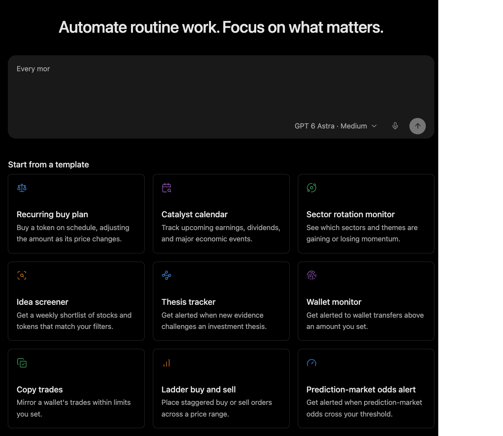

# Context and Tools

Context is assembled selectively. Tools are revealed when they are relevant. This keeps the model focused without removing runtime controls.

## Working context

Context can include the current request, conversation history, workspace information, memory, tool results, and task-specific instructions.

Not everything stored is placed into every model request. The harness loads what the task needs and can retrieve additional context as work develops.

Skills and instructions can guide the model. They are not an authorization grant, a sandbox, or a substitute for runtime checks.

## Tool discovery

Large tool libraries should not force every conversation to carry every schema. Minara can keep common capabilities ready while loading specialized tool definitions on demand.

With progressive disclosure, the model can discover compact tool names and descriptions first. If a tool becomes relevant, it can load the exact schema and use the tool with typed arguments.

This helps in three ways:

* **Less distraction:** the model does not need to read unrelated tool descriptions.
* **Lower overhead:** more context remains available for the task itself.
* **Targeted access:** common tools stay close, specialized tools load when needed.

Deferred loading changes what the model reads. It does not change what the model is allowed to do.

## Tool execution

The model proposes a tool call. The harness applies authorization, filesystem, credential, and execution-environment checks before running the handler.

The result returns to the conversation as an observation. The agent can continue, revise its approach, ask for input, or report a limitation.

A requested action and an observed outcome should remain distinct. A tool call asking to place an order is not evidence that an order was filled.

## Long-running context

Large outputs and long conversations can exceed the model's working context. Minara can compact context and retrieve durable records so the task can continue.

Compaction is not a lossless copy of everything that happened. It is also separate from durable memory. If a later step depends on a detail, the agent should retrieve or check it again instead of relying on a vague summary.

## Interruptions and recovery

Provider failures, expired authorization, missing environment, unavailable tools, or failed commands can stop a step from completing. The agent should report the actual state rather than infer success from intention.

Retries are sensitive when a tool changes external state. If a submission times out, the safer next step may be to query status, not submit again.
