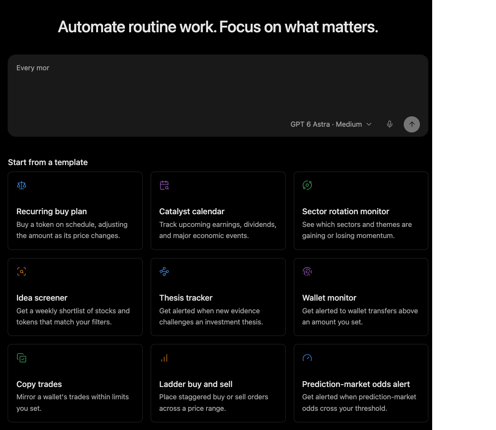

# Memory and Learning

Memory gives Minara continuity beyond one conversation. It helps the agent connect current work with prior preferences, decisions, and retained lessons.

## What memory can do

Memory can help Minara recall relevant preferences, revisit earlier reasoning, track a thesis, and reuse lessons from past tasks.

Trading memory connects available activity with captured decision context: what the agent was trying to achieve, why an action was considered, and what evidence later became available.

That is more useful than a transaction list alone. A transaction says what happened. A memory record can preserve the reasoning and conditions that made the decision seem reasonable at the time.

## What memory cannot do

Memory is not automatic model retraining. It does not prove that a past decision was correct. It cannot authorize a new financial action.

Coverage also depends on connected accounts and enabled capture features. Minara should not pretend every external trade, chat, or portfolio event becomes a complete learning example.

## Learning loop

Useful experience can move through a loop: observe, reflect, distill, and reuse. The result is better context for future work, not a guarantee of better returns.

**Observe → Reflect → Distill → Reuse**

The loop can preserve useful lessons, revisit weak assumptions, and refine working methods as evidence accumulates. A profitable outcome alone does not prove that the reasoning was sound. A losing trade does not automatically prove that the thesis was wrong.

## Selective recall

Memory should be retrieved selectively. A past thesis, preference, or mistake may be useful context, but the current task may still need fresh market and account evidence.

> Remembered preferences and earlier approvals are context, not permission for a new financial action.

The safety gates remain responsible for authorization.
