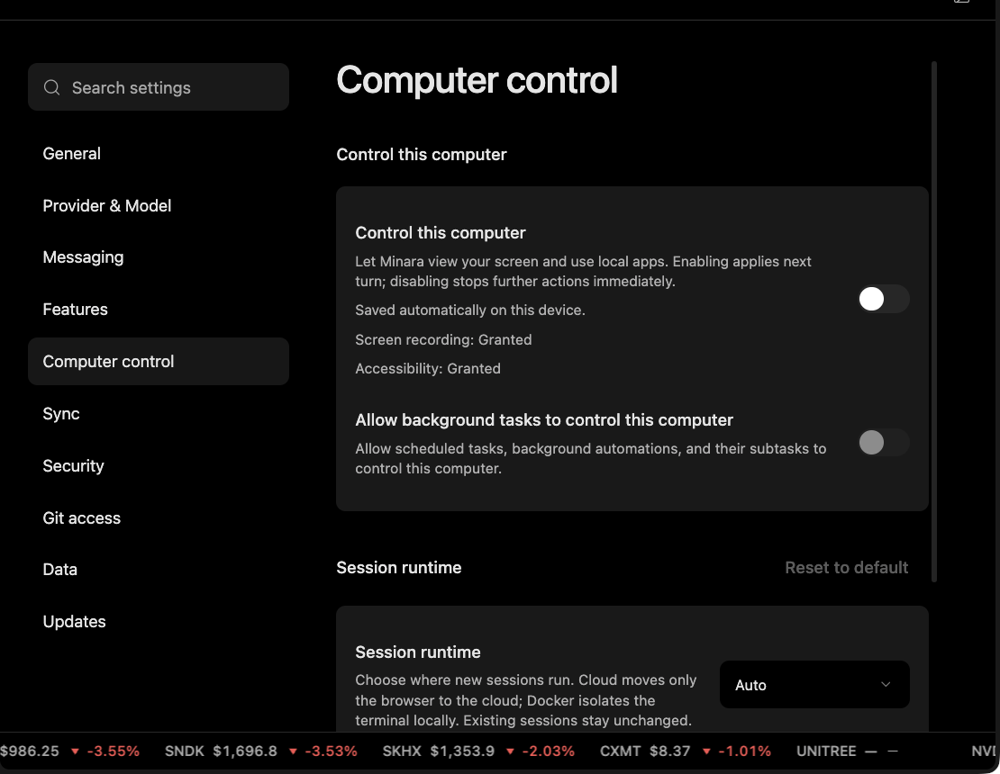

# Session Workspace

The session workspace is the task's working area. It gives Minara a place to inspect files, create artifacts, run permitted commands, and preserve reviewable outputs.

## What belongs in the workspace

The workspace can contain project files, generated scripts, analysis outputs, screenshots, notes, and other artifacts created for the current task.

It is the model-visible file layer. File tools, terminal commands, code execution, generated media, attachments, and exported deliverables should resolve through this layer instead of handing the model host-only paths it cannot read.

## What stays outside

Account policy, long-lived credentials, device-level permissions, and host control state are not ordinary task files. The model may need to know whether a capability is available, but it should not receive raw secrets.

Minara treats this as a layered system:

| Layer                      | User-facing meaning                                                                                          |
| -------------------------- | ------------------------------------------------------------------------------------------------------------ |
| Control plane              | Account state, preferences, credentials, approvals, logs, and runtime pins.                                  |
| Session workspace          | The task's files, artifacts, runtime outputs, and model-visible paths.                                       |
| Bridge in                  | Attachments, browser downloads, or screenshots become usable only after they are written into the workspace. |
| Bridge out                 | Verified deliverables can be exported back to the host.                                                      |
| Browser or desktop runtime | Page state and desktop state can inform a task but are not automatically workspace files.                    |

The important rule is simple: if the model receives a path, that path should be readable in the session workspace.

## Desktop bridge

Desktop control is explicit and permissioned. A task can use screen or local application context only when that capability is enabled and relevant to the user's request.

Desktop control is not passive background screen awareness. It is a task capability. Users should enable it only when the task needs local UI context, and they should close unrelated private material before using it.

## Local, cloud, and isolated runtimes

Minara can place execution and browser work differently depending on configuration. A local desktop task may use local files and local browser state. A hosted task may use a host workspace and a cloud browser. An isolated runtime may use a remote workspace for code execution.

The user-facing effect is the same: files, commands, screenshots, and downloads should be routed so the agent can actually inspect the outputs it refers to.

## Path and write boundaries

Reading a file, writing a file, running a command, and accessing a credential are separate decisions. The workspace gives the task a working location; it is not a universal security boundary by itself.

Protected control-plane files, credential-bearing paths, and unrelated user work need stronger rules than ordinary task artifacts. When a task changes files, a correct result stays within the requested scope and preserves unrelated edits.
