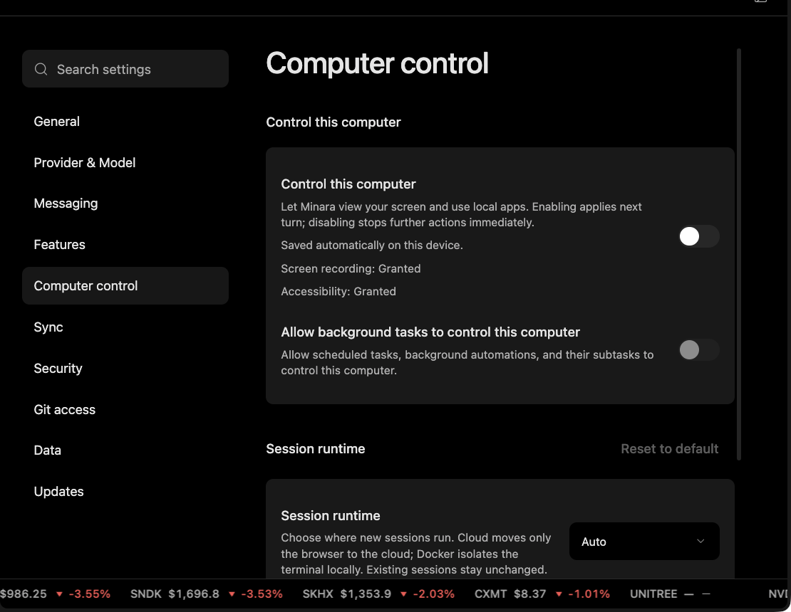

# Files, Secrets, Execution

File access, credential handling, and code execution are separate controls. Permission in one area does not grant unrestricted authority in another.

## Files

Tools that modify files should stay within the requested scope and preserve unrelated user work.

Path protections and write policies should distinguish ordinary task artifacts from protected control-plane files, credential-bearing paths, and unrelated user work. The workspace gives a task a working location, but it is not by itself a complete security boundary.

For coding tasks, preserving existing work is part of correctness. A successful change should not overwrite unrelated edits just to make the task easier.

## Secrets

The model often needs to know whether a credential is configured, not its raw value. Secret tools should expose names and masked status rather than credential values.

If a credential is missing, the product should request it through a dedicated input flow. The raw value should not come back in a model-facing tool response.

This separates using a credential from disclosing it. It is not a claim that authorized execution code can never access a supplied secret; that code and its environment still need appropriate controls.

## Execution

Code runs in the configured environment. The workspace is useful, but it is not by itself a complete security boundary.

Runtime checks work alongside the isolation available in the deployment, such as operating-system or container boundaries. Prompts and skills guide behavior; they do not replace enforced controls.

Permission to read a file is not permission to access credentials. Permission to run analysis is not permission to trade. These are independent safeguards.
