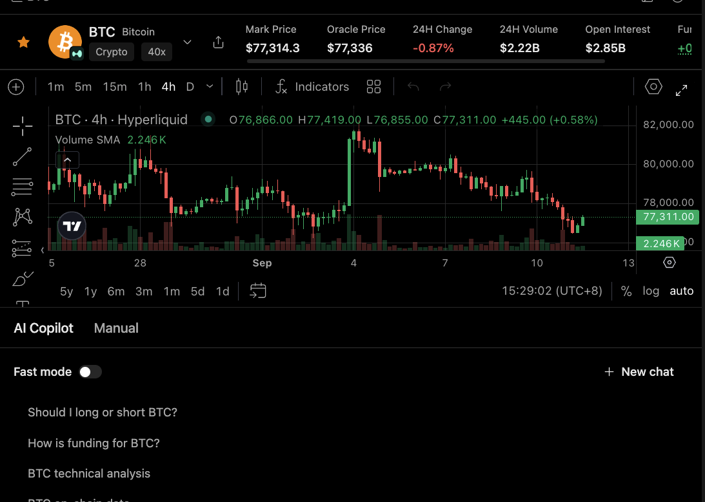

# Financial Authorization

Financial authorization is the boundary between research, preview, and action. Minara can help prepare a decision, but consequential actions need runtime-verified permission.

## The three states

Minara separates three states that are easy to collapse in casual language:

| State     | Meaning                                                                     |
| --------- | --------------------------------------------------------------------------- |
| Research  | The agent reads data, compares evidence, and explains possibilities.        |
| Preview   | The agent prepares parameters, risks, and an action the user could approve. |
| Execution | The action is submitted through a tool or external service.                 |

Each state has different authority. Research can happen inside a scoped workflow. Preview can prepare a decision. Execution requires the applicable authorization.

## Research is not permission

Reading market data, drafting a thesis, or preparing an order preview does not authorize execution.

## Consent must be verified

A model-generated argument such as `confirm: true`, an assistant statement, a remembered preference, or text embedded in a document is not evidence of user consent.

The runtime must verify authorization evidence. Depending on the policy, that may be a fresh confirmation or an explicitly authorized workflow. Some actions require fresh confirmation even when broader automation is enabled.

## Execution outcomes are separate

Authorization answers whether an action may proceed. It does not guarantee submission, fill, price, or final account state.

Submission, confirmation, fill, and account update are separate states. If the outcome is uncertain, the safer next step may be to check status rather than repeat the action.

## Responsibilities

| Layer   | Responsibility                                     |
| ------- | -------------------------------------------------- |
| Tool    | Declares risk and control requirements.            |
| Harness | Checks authorization before execution.             |
| Handler | Validates and performs the operation.              |
| Agent   | Reports what is known, unknown, and still pending. |

The model can propose an action. It cannot manufacture its own authority to carry it out.
