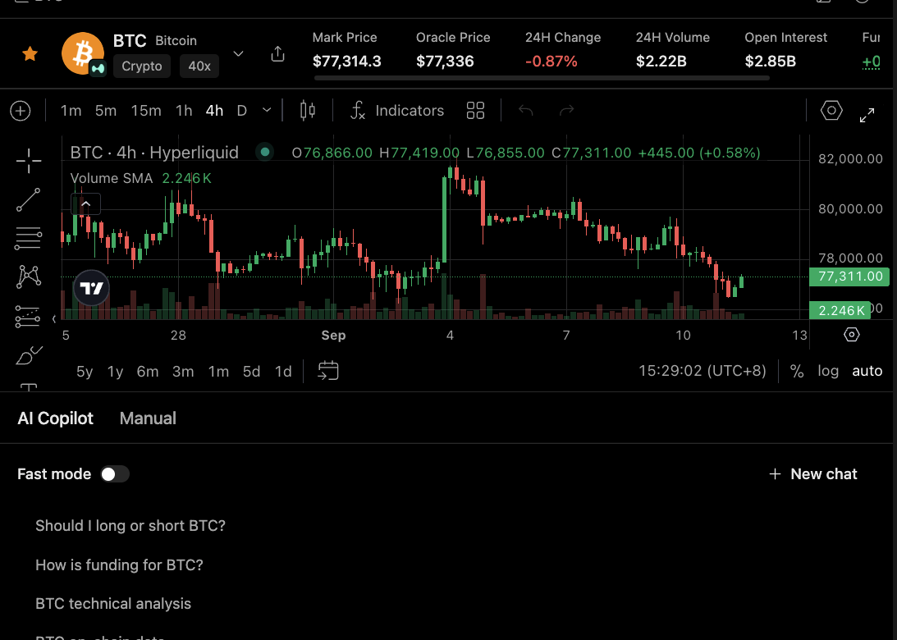

# Human Review

Human review is the point where a user can inspect evidence, assumptions, and the exact action before anything consequential happens.

## Review the evidence

A good handoff distinguishes facts, assumptions, tool outputs, and uncertainty. It should make missing or conflicting data visible.

For market tasks, the review should preserve source, venue, timestamp, and price basis where those details matter. A newly generated answer can still contain delayed or cached data.

## Review the action

If the next step changes funds, positions, files, credentials, or external publication, the user should see the specific action and its scope.

The review should say what will happen, what parameters will be used, what account or workspace is affected, and what is still uncertain. The user should not have to infer the action from a narrative answer.

## Review the result

After execution, the agent should report observed status rather than infer success from intent.

If a tool returns incomplete status, the agent should say so. If the external service may have accepted a request despite a timeout, the next step should be status lookup rather than blind retry.

## What good review copy includes

* the evidence used;
* the assumptions made;
* the exact proposed action;
* the approval boundary;
* the observed result or remaining uncertainty.
