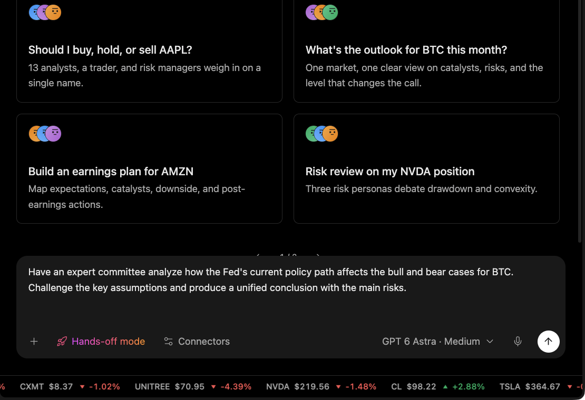

# Task Walkthrough

Use this page as the shortest path through Minara Harness. It follows one research-to-review workflow from the user's request to a bounded result.

## The example workflow

A user asks Minara to review a market and prepare a possible action. The task may involve market pages, strategy records, portfolio scope, memory, and a final recommendation. The harness turns that request into a controlled loop:

1. assemble context;
2. call tools;
3. review observations;
4. stop at gates;
5. hand off a result the user can inspect.

The model does the reasoning. The harness decides what is visible, which tools are available, where work runs, and when a step needs review.

## 1. State the goal

The user should describe the decision, horizon, and output format. A useful request is narrower than "what should I buy?" For example: compare the current BTC setup across funding, open interest, recent price action, and portfolio exposure; return the bullish case, bearish case, invalidation levels, and what would need approval before an order.

This framing matters because the harness can then select the right context. A market scan, a portfolio exposure answer, and a trade preview all touch different surfaces.

## 2. Assemble context

The harness loads the relevant session instructions, workspace records, available memory, market tools, and account boundaries. It does not load every connected tool or every remembered fact into every request.

Context can include:

* the current request and conversation history;
* session or project instructions;
* workspace files and generated artifacts;
* retrieved memory;
* market, portfolio, strategy, browser, or desktop observations;
* tool results from earlier steps.

Selective loading is deliberate. It reduces irrelevant context while still allowing the agent to discover specialized capabilities when needed.

## 3. Run tools inside scope

The agent can read market pages, query connected tools, inspect files, run permitted code, and use desktop capabilities when enabled. Tool results return to the conversation as observations, not as proof that an external action succeeded.

The agent should keep requested actions and observed outcomes separate. Asking for an order preview is not the same thing as placing an order. Seeing a strategy backtest is not the same thing as live performance.

## 4. Stop at gates

Trades, transfers, publication, credential disclosure, destructive file changes, and broad desktop control remain gated. A model cannot create its own authority by writing a confirmation parameter.

If a submission times out or a provider fails, the next step may be to check state rather than retry the same action. This is especially important for external systems that can change funds, positions, or published content.

## 5. Record useful outcomes

The final answer, artifacts, and selected lessons can improve future context. Memory supports judgment; it is not current financial consent.

Good handoff language should say:

* what was checked;
* which sources were used;
* what remains uncertain;
* what the user would need to approve before action;
* where any artifact or follow-up record lives.

## Limits

The walkthrough describes the loop, not a guarantee of outcome. The harness can control context, tools, authorization, and execution flow. It cannot remove market risk, make stale data current, or turn a research prompt into financial authority.
