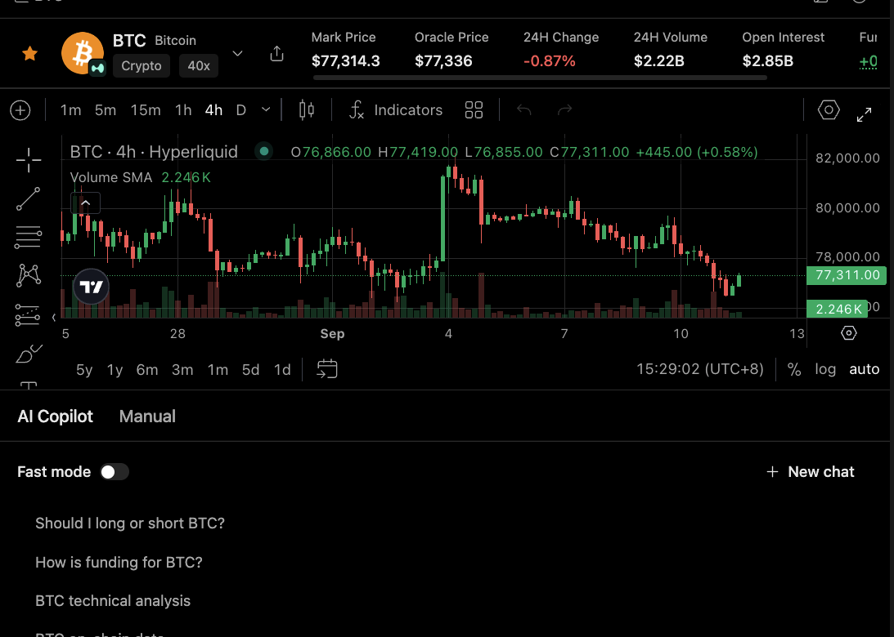

# Ask Copilot About an Asset

Use this workflow when the user is on an asset page and wants an explanation tied to visible data, such as funding, open interest, mark price, oracle price, or chart context.

## Output

A focused explanation that names the visible fields, gives both sides when the question calls for it, and avoids turning analysis into a trade recommendation.

## Harness behavior

The asset page gives Copilot task context. The harness should keep the answer grounded in visible evidence and preserve timestamps, venue, and field meaning where they matter.

## Good prompt shape

Ask for a narrow explanation and a verification path. For example: explain the funding rate shown here, include the countdown, and do not recommend a trade.

## Limits

Copilot output is conditional analysis, not a validated predictive signal. Any quoted number should be checked against the page or source before use.
