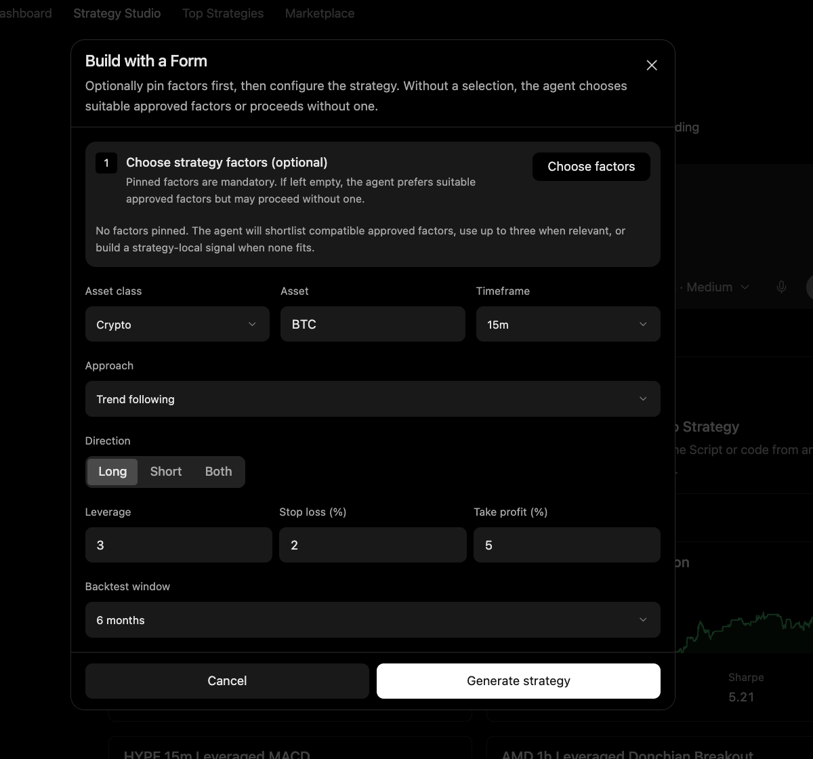

# Build a Strategy From Inputs

Use this workflow when the user wants Strategy Studio to generate a strategy from structured inputs, plain language, approved factors, video, or existing code.

## Output

A strategy draft with explicit market, timeframe, direction, leverage, stop loss, take profit, and backtest assumptions.

## Harness behavior

Minara Harness makes assumptions visible before code generation and keeps paper trading or live deployment as separate actions.

## What to check

* Asset class, asset, timeframe, approach, and direction.
* Leverage, stop loss, take profit, and backtest window.
* Generated code before backtest.
* Backtest behavior before paper trading.

## Limits

Paper trading is not live execution. Live deployment is a separate action and should remain behind the applicable authorization boundary.
