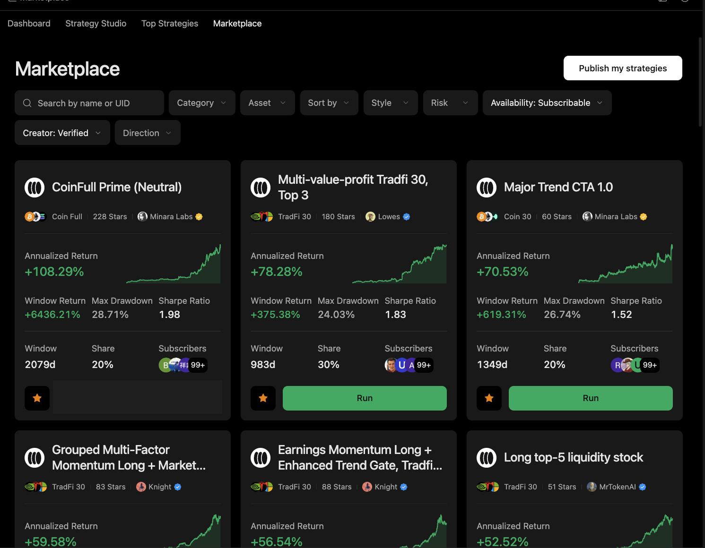

# Compare Strategies

Use this workflow when the user wants to shortlist strategies from Top Strategies, Marketplace filters, or a strategy detail page.

## Output

A strategy comparison that reads return, Sharpe, max drawdown, fills, evaluation window, creator verification, and availability together.

## Harness behavior

Minara Harness keeps backtest limits, sample size, and live-run evidence visible so a high return number does not become a shortcut.

## What to check

* Category, asset, style, risk, availability, and direction filters.
* Annualized return, window return, maximum drawdown, Sharpe ratio, subscriber count, and evaluation window.
* Strategy description, author information, and available backtest report.

## Limits

Marketplace metrics and backtests are not investment guarantees. They can overfit and may not include live slippage, liquidity limits, fees, or changing market regimes.
