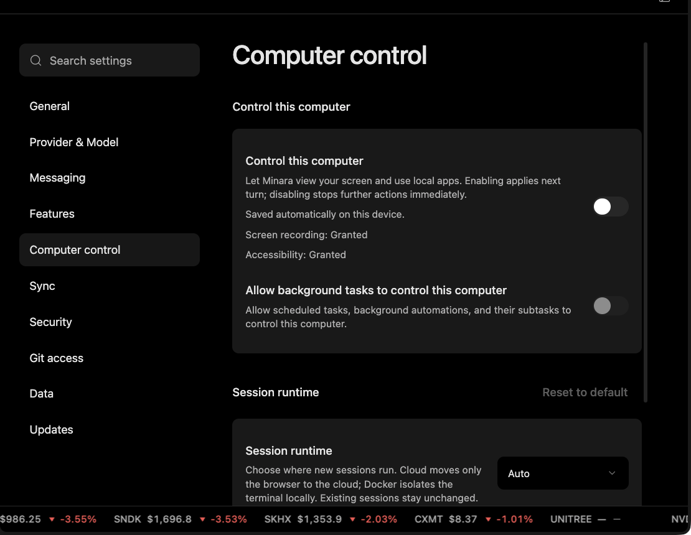

# Enable Computer Control

Use this workflow when the user wants Minara to view the current screen or use local applications for a specific task.

## Output

A permissioned desktop task with screen recording, accessibility state, scope, and explicit limits.

## Harness behavior

Computer control requires user-enabled permission. The harness should favor narrow read-only tasks first and should not treat computer control as passive continuous screen awareness.

## What to check

* Screen recording permission.
* Accessibility permission.
* Whether computer control is on for the next task.
* Whether background task control is enabled or unavailable.

## Limits

Enabling control gives Minara access to screen content for the task. Hide unrelated private material before using it.
