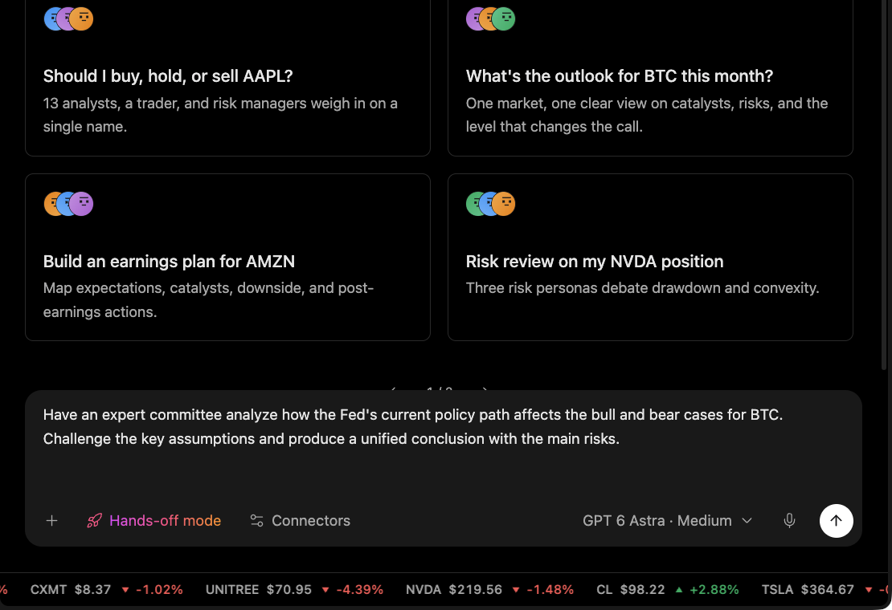

# Run an Institution-Style Review

Use this workflow when a user wants one research question reviewed through multiple specialist perspectives before forming a unified view.

## Output

A structured review with competing views, assumptions to challenge, conditions that would change the conclusion, and main risks.

## Harness behavior

The harness keeps research workflows separate from authorization. A multi-perspective report is not permission to move funds.

## What to check

* Asset, tickers, or research question.
* Horizon and decision context.
* Assumptions to challenge.
* Required output format.
* Cited data, timestamps, and conditions that would change the conclusion.

## Limits

Institution is a research workflow, not an autonomous personal CIO.
