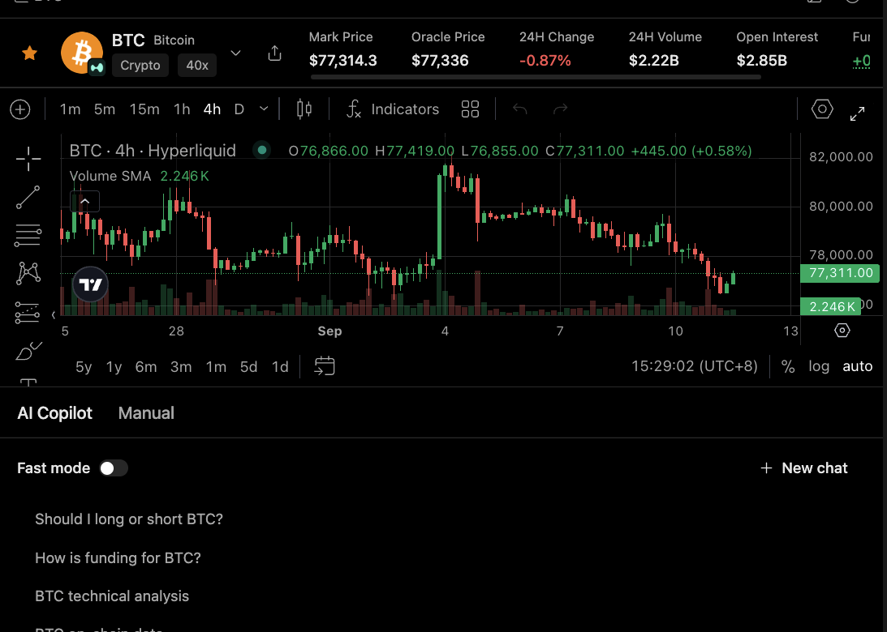

# Review a Market Before an Order

Use this workflow when the user wants to prepare an order by reviewing market context and position-specific estimates before any final confirmation.

## Output

A pre-order checklist that distinguishes market data from order-specific estimates and identifies the exact approval boundary.

## Harness behavior

Minara Harness allows read-only review and hypothetical inspection, then stops before any final confirmation or fund movement.

## What to check

* Symbol, venue, and market type.
* Mark price and oracle price.
* Volume, open interest, funding, and timeframe.
* Quantity, notional, margin, leverage, take-profit, stop-loss, and estimated liquidation.

## Limits

This page is a preparation surface, not a universal safety guarantee. Prices, fees, funding, and liquidation estimates can change between review and execution.
