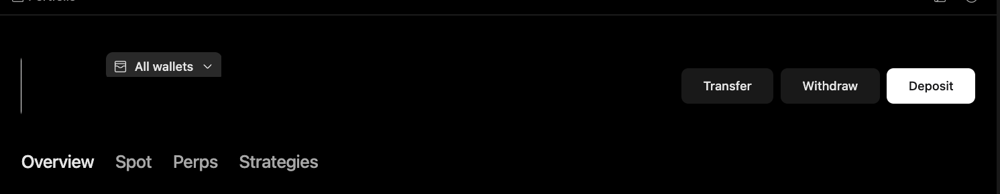

# Review Portfolio Scope

Use this workflow when the user asks about holdings, exposure, or strategy activity and the answer must be limited to connected Minara wallets and accounts.

## Output

An exposure summary that separates spot, perps, and strategies, and states which accounts or asset classes are outside the result.

## Harness behavior

The harness reads scope before analysis so a connected-wallet view is not presented as the user's complete financial picture.

## What to check

* Connected-wallet count.
* Selected wallet scope.
* Overview, Spot, Perps, and Strategies tabs.
* Missing exchange accounts, external wallets, or off-platform assets.

## Limits

Portfolio does not automatically consolidate every financial account. It covers the Minara wallets and accounts available to the app.
