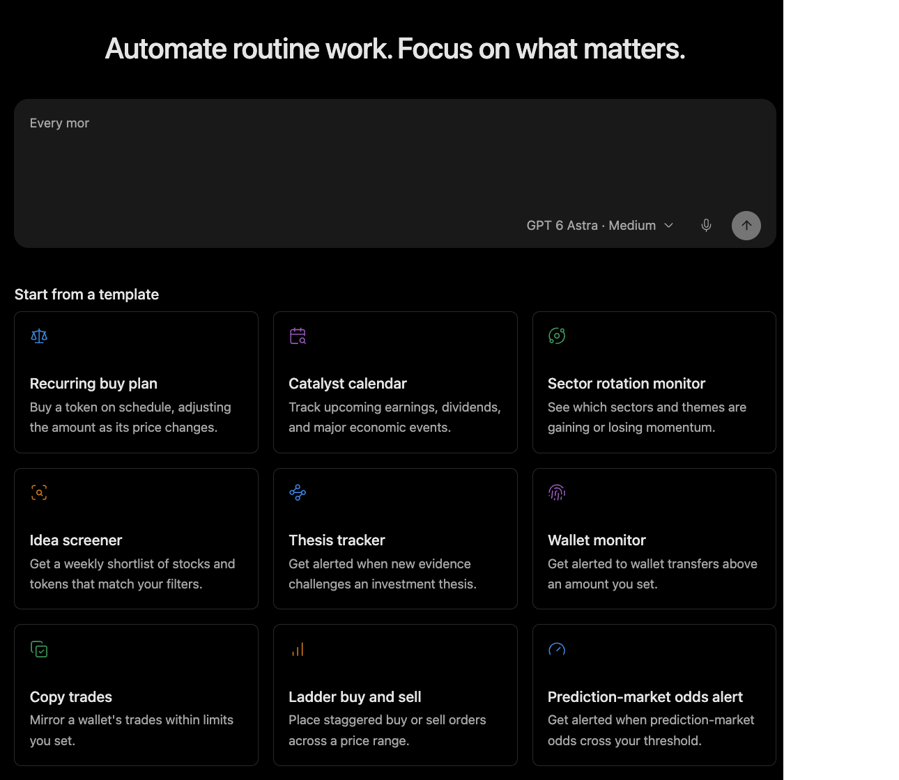

# Create Recurring Research

Use this workflow when the same market question returns on a schedule, such as a weekday digest, catalyst calendar, sector rotation monitor, or idea screener.

## Output

A scheduled workflow with subject, sources, schedule, output format, destination, and first-run status.

## Harness behavior

The harness runs bounded research and notifications through configured connectors without assuming access to every paid or authenticated source.

## Prompt shape

A useful instruction names the subject, sources, schedule, and output. Keep the workflow read-only until the result format is reliable.

## Limits

Minara manages automations and notifications configured in its own workspace and connected services. External delivery requires the relevant connector.
