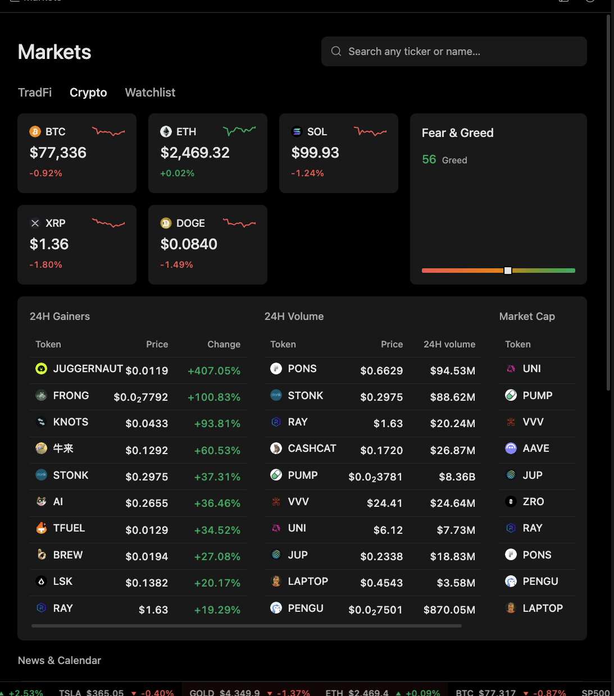

# Scan Markets Before Research

Use this workflow when a user wants a first pass over TradFi indices, sector breadth, crypto majors, gainers, volume leaders, or market-cap leaders.

## Output

A market scan that separates index movement, sector rotation, crypto leaders, volume, sentiment, and follow-up assets.

## Harness behavior

Minara Harness loads market surfaces on demand and keeps source, venue, freshness, and instrument identity visible. A leaderboard move is a reason to inspect further, not a standalone trade signal.

## What to check

* Wait for market cards and lists to finish loading.
* Compare broad indices, sector heatmaps, leaders, losers, and active names.
* For crypto, distinguish percentage gainers, volume leaders, market-cap leaders, and sentiment.
* Open an individual asset before making any decision based on a list.

## Limits

Market overviews are snapshots. They are not complete research reports or current execution quotes.
