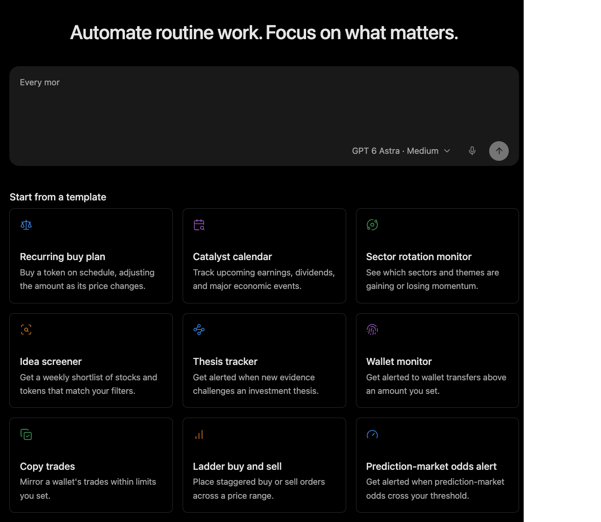

# Track a Thesis

Use this workflow when the user wants Minara to watch whether new evidence challenges a written investment view.

## Output

A tracker with the asset, thesis, invalidation conditions, evidence standard, review frequency, and notification rule.

## Harness behavior

Minara Harness separates a thesis from an alert rule, reduces noisy notifications, and records useful memory only when the user wants it retained.

## What to check

* The thesis is written separately from the alert condition.
* The evidence standard is specific enough to reduce false alarms.
* The first run includes cited evidence and distinguishes invalidation from ordinary volatility.

## Limits

A thesis tracker does not create an immutable trade journal or automatically connect every alert to an exchange fill.
