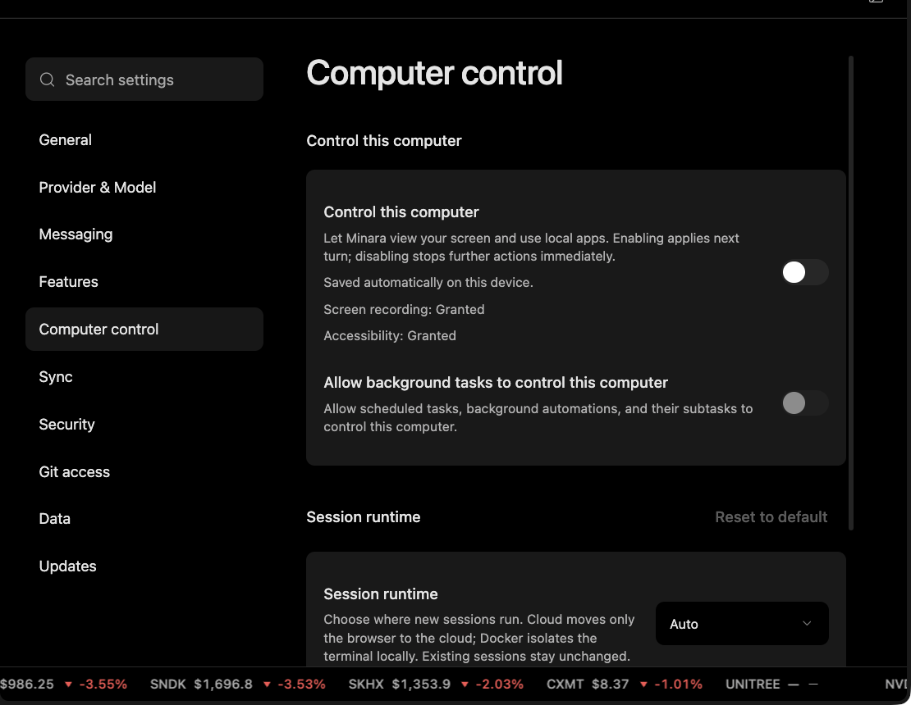

# Desktop workspace

Each task in the Minara desktop app has its own workspace: a place where Minara can read your files, create new ones, run analysis, and save the results for you to review.

## What goes in the workspace

* Files you share, such as spreadsheets, documents, and screenshots.
* Scripts and code Minara writes for the task.
* Charts, reports, and other results.

Everything Minara refers to in its answer should be something you can open and check.

## Coding and analysis

Some questions need more than a quick lookup. Minara can write and run code to combine data, test an idea, or automate a repeat analysis, and keep the script so you can reuse it.

When working on your code or files, Minara:

* stays within what you asked for;
* doesn't overwrite unrelated work;
* runs checks where it can, and tells you what it verified and what it didn't.

Being able to run code does not give Minara permission to trade, move funds, or publish anything. Those still need your approval.

## Computer control

In the desktop app, you can let Minara see your screen and use other apps on your computer for a specific task. This is off by default.

<figure><figcaption></figcaption></figure>

### Turn it on

In the desktop app settings, check that:

* **Screen recording** permission is granted;
* **Accessibility** permission is granted;
* computer control is turned on for your next task;
* background task control is on, if you need it and it's available.

Start with simple, read-only tasks, such as "look at this chart and summarize it", before asking Minara to click or type for you.

When computer control is on, Minara can see what's on your screen for that task. Close anything private and unrelated first. Minara does not watch your screen in the background; it only uses your screen when a task needs it.

## Passwords and API keys

Minara can know that a key or login is set up, but it never sees or shows the actual value. If something is missing, Minara asks you to add it through a secure input, not in the chat.

For how your wallet and data are protected, see [Wallet security](../technology/wallet-security.md) and [TEE-based data security](../technology/data-security.md).
