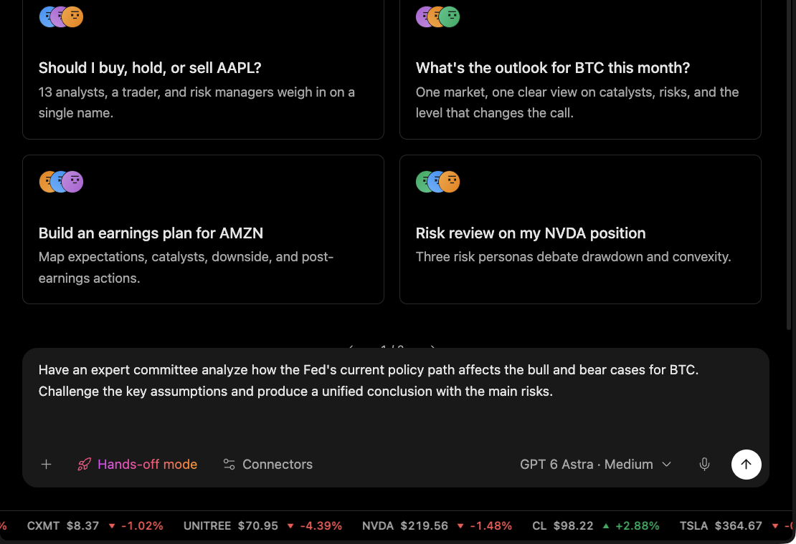

# Institution review

Use this when you want one investment question looked at from several expert angles before you form a view.

<figure><figcaption></figcaption></figure>

## What you get

A structured review with competing views, the assumptions worth challenging, what would change the conclusion, and the main risks.

## What to include in your request

* The asset, tickers, or question.
* Your time horizon and the decision you're facing.
* Any assumptions you want challenged.
* The format you want back.

## What to check in the result

* The data cited and when it's from.
* The conditions that would change the conclusion.

## Keep in mind

Institution review is a research tool. It doesn't place trades or make decisions for you.
