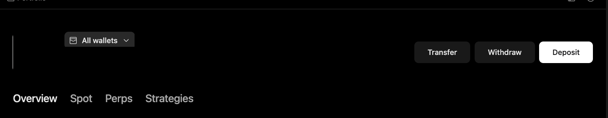

# Portfolio coverage

Use this when you ask about your holdings, exposure, or strategies, and want to know exactly which accounts the answer includes.

<figure><figcaption></figcaption></figure>

## What you get

An exposure summary split into spot, perps, and strategies, and a clear note of which accounts or assets are not included.

## What to check

* How many wallets are connected, and which ones are selected.
* The **Overview**, **Spot**, **Perps**, and **Strategies** tabs.
* Any exchange accounts, outside wallets, or other assets that aren't included.

## Keep in mind

Your portfolio view only covers the Minara wallets and accounts connected to the app. It isn't a complete picture of everything you own unless you've connected it all. To give Minara context on wallets outside Minara, you can import them in [Personalization](./personalization.md).
