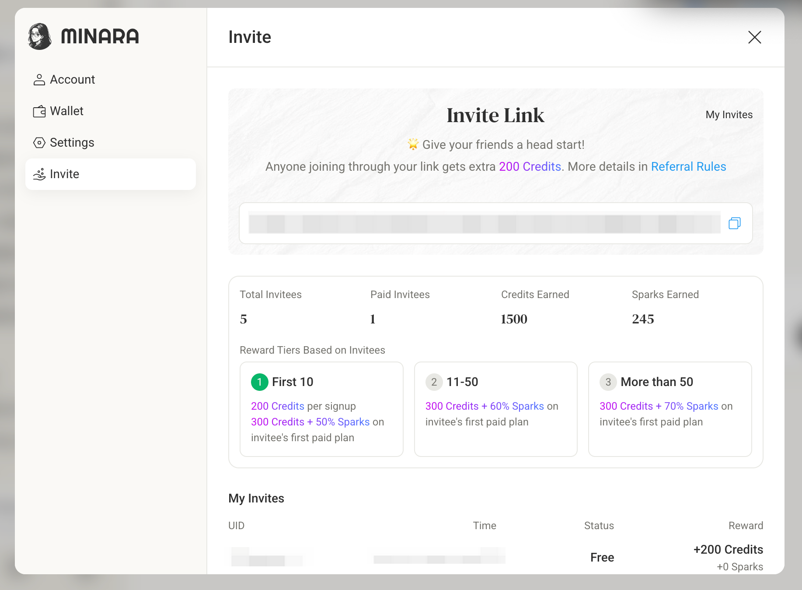

# AI trading copilot

Minara Trading Copilot is an AI trading assistant for perpetual markets. It analyzes live price action, order-book liquidity, funding, and open interest, then returns a structured long, short, or neutral trade plan. Each plan includes an entry price, take-profit, stop-loss, and a short explanation. You review the proposed risk and choose whether to execute it on Lighter or Hyperliquid.

Access Trading Copilot at: [copilot.minara.ai](https://copilot.minara.ai)


**Leveraged trading carries risk of total loss.** Copilot signals are suggestions, not guarantees. Each trade uses leverage, and positions can be liquidated when the price moves against you. Read [Liquidations](../trading-reference/liquidations.md) and [Margin & leverage](../trading-reference/margin-and-leverage.md) before executing your first signal.


***

## 1. How Copilot generates signals

When you click **Ask Long** or **Ask Short**, Copilot evaluates the following inputs and produces a structured trade plan:

**Market structure and price action**

* Multi-timeframe candlestick data matched to your selected trading style
* Trend direction, volatility structure, key price levels
* Technical indicators: EMA, RSI, MACD

**Order book and liquidity**

* Real-time order book depth
* Bid/ask imbalance and recent trade flow

**Derivatives market signals**

* Funding rate history and direction
* Open interest changes
* Positioning dynamics from derivatives data

**Risk filtering**

Before presenting a signal, Copilot filters out setups with unfavorable risk-to-reward ratios, insufficient stop-loss buffers, or structurally invalid risk parameters.

The output includes:

* Trade direction: Long, Short, or Neutral
* Suggested entry price, take-profit (TP), and stop-loss (SL)
* Brief explanation of the signal rationale

<figure><figcaption></figcaption></figure>

***

## 2. Signal parameters you control

**Trading style**: determines the timeframe Copilot focuses on:

* `Scalping`: 3-minute chart, short in-and-out trades
* `Day`: 15-minute chart, same-day entries and exits
* `Swing`: 4-hour chart, positions held days to weeks

**Strategy**: determines the type of setup Copilot looks for:

* `Max Gain`: high reward-to-risk setups with strong backtest upside; fewer trades, larger moves
* `Max Win Rate` _(coming soon)_: higher-probability setups with more flexible entry conditions

**Initial margin**: your default margin amount for quick orders. Does not affect signal output.

***

## 3. Supported assets

Copilot generates signals for perpetuals available on Lighter and Hyperliquid. This includes:

* Crypto: Bitcoin (BTC), Ethereum (ETH), Solana (SOL), and hundreds of other tokens
* Commodities: gold (XAU), silver (SILVER), crude oil
* Stocks: Apple (AAPL), Tesla (TSLA), NVIDIA (NVDA), Amazon (AMZN), Microsoft (MSFT), and other major US equities

***

## 4. Infrastructure

Minara does not provide liquidity or act as a counterparty. Perpetual trades execute on Lighter or Hyperliquid, depending on which wallet you use. Pricing, leverage, funding rates, and liquidity come from the underlying exchange. Minara is the AI interface and execution layer on top.

***

## 5. Deposit and transfer funds

Before trading, you need funds in a Lighter or Hyperliquid perps wallet. See [Deposit](../guide/managing-funds-and-trading/deposit.md) for creating a wallet, depositing USDC, and transferring funds between wallets including across the two exchanges.

***

## 6. Executing a trade

Once Copilot generates a signal, it pre-fills a limit order with the suggested entry, take-profit, and stop-loss. Before confirming, you can adjust:

* Leverage
* Initial margin

Place the order with one click. Manual market and limit orders are also available for advanced users.

***

## 7. Managing open positions

**Close all positions**: closes all open positions at market price (requires confirmation).

**Manual close**: close individual positions via market or limit order.

**Set take-profit and stop-loss on open positions:**

Go to Trade > Positions, select a position, and click "Add":

<figure><figcaption></figcaption></figure>

Set TP and/or SL values, optionally add split targets, then confirm:

<figure><figcaption></figcaption></figure>

Your take-profit and stop-loss are now active on the position:

<figure><figcaption></figcaption></figure>

Realized PnL updates immediately after execution.

***

## 8. Open order management

You can cancel individual pending orders or use **Cancel All Orders** to clear everything at once.

***

## 9. Margin mode

Copilot supports both margin modes:

* `Cross margin`: all positions share the same margin balance
* `Isolated margin`: margin is isolated per position

Switch margin modes directly in the trading interface.

***

## 10. Trading Copilot FAQ

### What is an AI trading copilot?

An AI trading copilot analyzes current market data and proposes a trade plan for review. Unlike a trading bot, it does not require you to hand over the final decision. In Minara, you choose the asset and direction, inspect the suggested entry and risk levels, and decide whether to place the order.

### How does a trading copilot work?

Minara combines price action, technical indicators, order-book data, funding rates, and open interest. It filters setups that do not meet its risk rules, then returns a structured signal with an explanation. Market conditions can change after a signal is generated, so you should review the latest price and risk before execution.

### What is the difference between Trading Copilot and a trading bot?

Trading Copilot proposes a trade for you to approve. A trading bot follows predefined rules and can place or manage trades automatically. Use [Autopilot](trading-autopilot.md) for automated execution, or [Strategy Studio](https://minara.ai/product/strategy-studio) to build and backtest a rule-based strategy.
