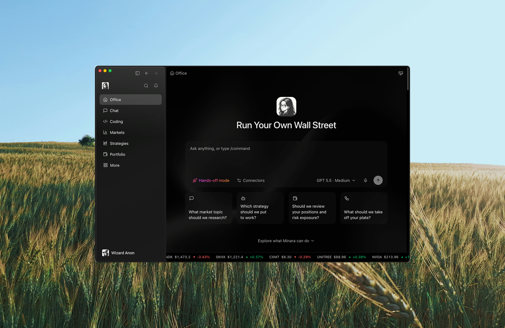

# How Minara works

A smart model can reason about a market. To be useful for real financial work, it also needs the right information, the right tools, and clear limits on what it is allowed to do. The system around the model that provides these is called the Minara Harness. It is what lets Minara go from a question to research, analysis, and, once you approve, action.

<figure><figcaption></figcaption></figure>

## What it means for you

* **Answers grounded in data.** Minara pulls live market data, your portfolio, and relevant history into each task, and tells you where its numbers come from.
* **You stay in control.** Minara can research and prepare a trade, but anything that moves your money waits for your approval.
* **It remembers what helps.** Useful preferences and lessons carry over, so you don't have to start from scratch every time.

The model reads your request, weighs the evidence, and proposes next steps. The harness decides what the model can see, which tools it can use, and when it has to stop and ask you. For example:

* Reading BTC funding data is quick and needs no approval.
* Preparing an order shows you the price, size, leverage, and risk before anything happens.
* Placing the order requires your confirmation.
* Remembering that you prefer low leverage helps Minara tailor its answers, but it never counts as permission to trade.

## From request to answer

### 1. You describe the goal

The clearer the request, the better the result. Instead of "what should I buy?", try something like:

> Compare the current BTC setup using funding, open interest, recent price action, and my portfolio exposure. Give me the bullish case, the bearish case, the levels that would prove each wrong, and what I'd need to approve before placing an order.

A good request names the asset or question, your time horizon, and the format you want back.

### 2. Minara gathers what it needs

Minara brings in only what's relevant to your request, such as:

* your request and the conversation so far;
* live market data, news, and on-chain information;
* your portfolio and strategy information;
* files you've shared and memories you've chosen to keep.

Specialized tools are brought in only when the task needs them, which keeps answers focused.

### 3. Minara does the work

Minara can read market pages, run analysis, check your portfolio, write and run scripts, and, if you've turned it on, use your computer for a specific task. See [Desktop workspace](../../features/desktop-workspace.md).

Throughout, Minara keeps a clear line between what it was *asked* to do and what *actually happened*. Previewing an order is not the same as placing it, and a backtest is not the same as live performance.

### 4. Minara stops when your approval is needed

Trades, transfers, publishing anything, and other actions with real consequences always wait for you. Minara can't approve these on its own. See [Safety and approvals](../../technology/safety-and-approvals.md).

### 5. You get a clear handoff

A good answer tells you:

* what was checked and which sources were used;
* what is still uncertain;
* what you'd need to approve before taking action;
* where any files or follow-ups are saved.

## About market data

Minara draws on many data providers. See [Tool Stack](../../technology/tools-integration.md) for the full list. A few things to keep in mind:

* **Sources can differ.** Different venues and providers may show slightly different numbers for the same asset. Minara tells you which source it used.
* **Prices mean different things.** A reference price, a mark price, and the price you can actually trade at are not the same. Research prices are not guaranteed execution prices.
* **Missing data is not "zero".** If a source is unavailable, Minara says so instead of guessing.
* **Old results don't update.** An earlier answer shows the data as it was then. Ask again for current numbers.

## When something goes wrong

If a data source is down, a connection is missing, or a step fails, Minara tells you what actually happened. If an order or transfer may have gone through despite an error, Minara checks its status first instead of trying again, so nothing is placed twice.

## What you can do next

| I want to...                                   | Guide                                                                                    |
| ---------------------------------------------- | ---------------------------------------------------------------------------------------- |
| Get a quick read on the market                 | [Scan the markets](../../features/scan-markets.md)                                       |
| Research an asset before trading               | [Research an asset before you trade](../../features/asset-research.md)                   |
| Get several expert views on one question       | [Institution review](../../features/institution-review.md)                               |
| Compare and shortlist strategies               | [Compare Top Strategies](../../trade/strategy-market/compare-top-strategies.md)          |
| Build a strategy from a form or plain language | [Strategy Studio](../../trade/strategy-studio/README.md)                                 |
| Get a market brief on a schedule               | [Scheduled briefs and reports](../../automation/scheduled-briefs-and-reports.md)         |
| Track an investment thesis                     | [Research monitors](../../automation/research-monitors.md)                               |
