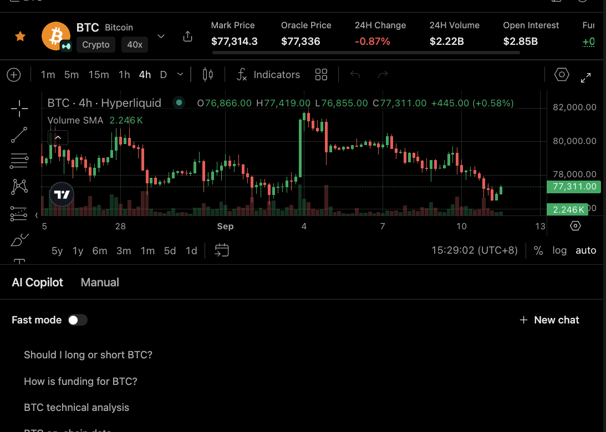

# Research an asset before you trade

Use this when you're on an asset page and want to understand what you're looking at, such as funding, open interest, mark price, or the chart, before preparing an order.

<figure><figcaption></figcaption></figure>

## Ask Copilot about what you see

Open **AI Copilot** next to the chart and ask a focused question. For example:

> Explain the funding rate shown here, including the countdown. Don't recommend a trade.

Minara answers using the numbers on the page, tells you where they come from, and gives both sides when it makes sense.

For signals and full trade plans, see [AI trading copilot](../../features/trading-copilot.md).

## Check before you place an order

Before confirming, review:

* the asset, venue, and market type;
* the mark price and oracle price;
* volume, open interest, and funding;
* your size, margin, leverage, take-profit, stop-loss, and estimated liquidation price.

Minara can walk through all of this with you and prepare the order, then stops so you can confirm. See [Safety and approvals](../safety-and-approvals.md).

## Keep in mind

Copilot's analysis is not a guaranteed prediction. Prices, fees, funding, and liquidation estimates can change between your review and the trade. Double-check any number before acting on it. To learn more, see [Order types](../../trading-reference/order-types.md), [Margin & leverage](../../trading-reference/margin-and-leverage.md), and [Liquidations](../../trading-reference/liquidations.md).
