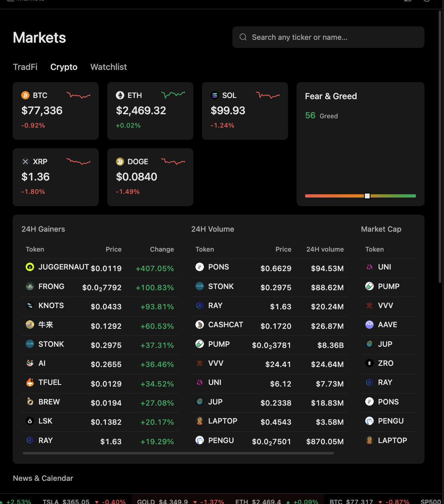

# Scan the markets

Use this when you want a quick first look across stock indices, sectors, crypto majors, top gainers, and volume leaders before digging into a specific asset.

<figure><figcaption></figcaption></figure>

## What you get

A market overview that separates index moves, sector rotation, crypto leaders, trading volume, and sentiment, plus a short list of assets worth a closer look.

## Tips

* Let the market cards and lists finish loading before you ask.
* Compare broad indices, sector heatmaps, top gainers and losers, and the most active names.
* For crypto, top gainers, volume leaders, and largest market caps tell you different things. Look at all three.
* Open the individual asset before acting on anything you see in a list.

## Keep in mind

A market overview is a snapshot. A big move on a leaderboard is a reason to look closer, not a reason to trade. Prices shown are not the price you'll get when you trade.
