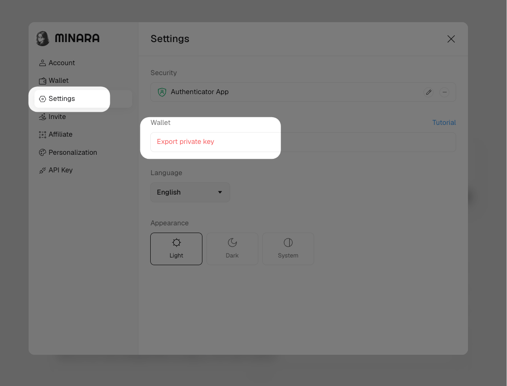
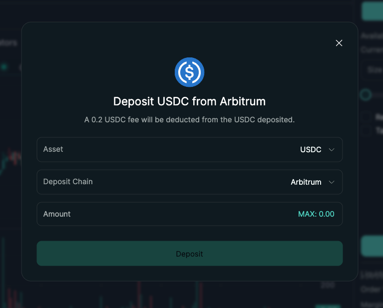
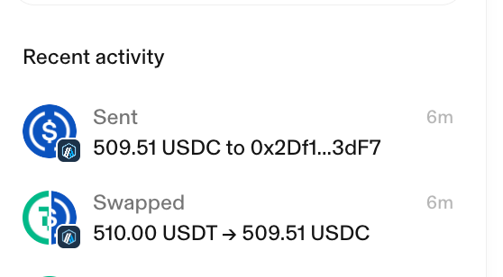
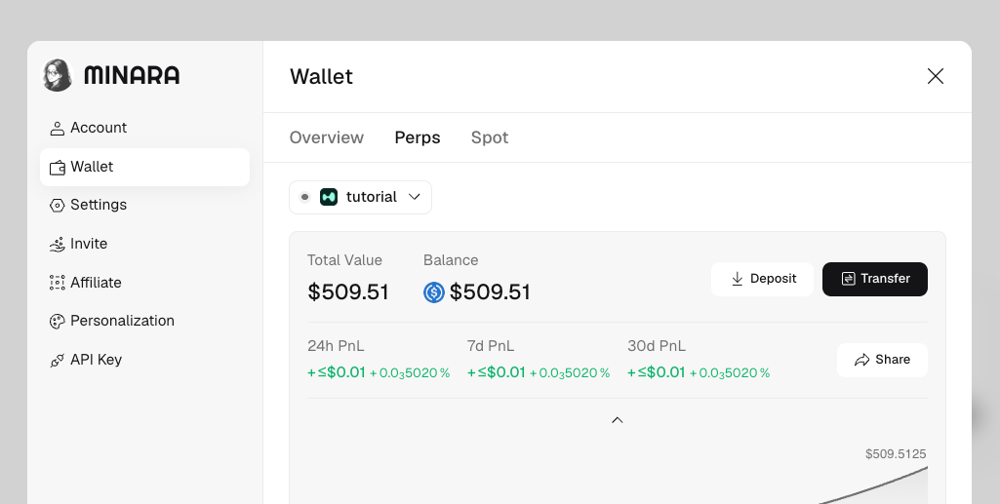

# On-chain deposit issues

## From outside to Minara

Covers depositing on-chain from a CEX (Binance, OKX, etc.) or another wallet into your Minara trading account.

**My on-chain deposit hasn't arrived.** Most deposits complete within 5–30 minutes. Use the explorer links below to check on-chain status before opening a ticket.

The core logic for any deposit issue:

* **On-chain record exists, but Minara balance hasn't updated** — your funds have reached Minara. Wait up to 15 minutes for the balance to reflect. If it still hasn't appeared after 15 minutes, open a ticket in our [Discord](https://discord.com/invite/minaraai) and report it as a bug.
* **No on-chain record yet** — your funds are still in transit on the blockchain. As long as the blockchain is not down, a submitted transaction will arrive. Keep waiting; it's a matter of time.

**I deposited to the wrong network.** Contact us on Discord. There is no guarantee that assets sent to the wrong network can be recovered. Include your transaction hash and the network you used.

**I deposited tokens from an unsupported chain.** Contact our Discord for technical support. Assets sent from unsupported chains may not be recoverable.

**I deposited the wrong token from the mobile app, such as USDT instead of USDC. How can I recover it?** If you sent a supported-network token that Minara does not show as a trading balance, the token may still be in your Minara wallet. For example, Minara recognizes USDC for Hyperliquid deposits, but not USDT. You can export your Minara wallet private key on the desktop web app, import that wallet into an external wallet, and move or convert the token from there.


Your private key gives full control over your wallet. Never share it with anyone, including Minara support. Only import it into a wallet you trust.


First, recover access to the wallet:

1. On a desktop browser, sign in to [minara.ai](https://minara.ai/).
2. Click your avatar in the top-right corner, then open **Settings**.
3. Under **Wallet**, click **Export private key**. For the full walkthrough, see [Export your private key](../wallet-and-security/export-private-key.md).
4. Import the private key into an external wallet such as MetaMask or Rabby.
5. Add a small amount of ETH on Arbitrum to this wallet. Both recovery methods below need Arbitrum ETH for gas.

<figure><figcaption></figcaption></figure>

Then choose one of these methods:

1. Withdraw the token from the imported wallet to an exchange or another wallet, convert it to USDC, then deposit USDC back into Minara.
2. Swap the token on an on-chain DEX such as [Uniswap](https://app.uniswap.org/swap) into USDC on Arbitrum. Then open [Hyperliquid](https://app.hyperliquid.xyz/), connect the imported wallet, and deposit the Arbitrum USDC. After you click **Connect** and **Deposit**, the wallet sends USDC to Hyperliquid's deposit vault:

```
0x2Df1c51E09aECF9cacB7bc98cB1742757f163dF7
```

Wait a few minutes after the deposit. The USDC should appear in your Minara Perps wallet.

<figure><figcaption></figcaption></figure>

<figure><figcaption></figcaption></figure>

<figure><figcaption></figcaption></figure>

**My deposit is confirmed on-chain but my balance hasn't updated. How do I trace it?**

If you contact support, include your Minara UID and the deposit wallet address. For Hyperliquid, the wallet address is enough. For Lighter, also share the "View on Explorer" link from your Lighter wallet page.

<figure><figcaption></figcaption></figure>

_**Hyperliquid**_

1. Open [hypurrscan.io](https://hypurrscan.io/) and paste your Hyperliquid wallet address.
2. Look for a matching deposit coming in from Arbitrum.

If the Arbitrum deposit is present, your funds have reached Hyperliquid on-chain and are at Minara. Wait up to 15 minutes for the balance to update. If it still hasn't appeared:

* Confirm you are viewing the correct wallet (the one you deposited into, not another wallet on your account).
* Try refreshing the browser on a stable network.
* Check for open perps positions with unrealized losses. The figure shown is your _available_ balance — the exchange moves balance into margin when positions go underwater, which reduces the displayed number.

If none of those explain it, open a ticket in our [Discord](https://discord.com/invite/minaraai) with the explorer link and your UID, and report it as a bug.

If no Arbitrum deposit is present, check [arbiscan.io](https://arbiscan.io/) for a transfer from your wallet to the Hyperliquid Deposit Bridge. Your funds are still in transit on-chain. As long as the blockchain is not down, the transaction will arrive — keep waiting.

_**Lighter**_

1. Open the [Lighter Explorer](https://app.lighter.xyz/explorer) and filter for _L1 deposit_.
2. Check whether your deposit is listed with the correct amount.

If the deposit appears with the right amount, your funds have reached Lighter on-chain and are at Minara. Wait up to 15 minutes for the balance to update. Run through the same display checks as above (correct wallet, refresh, perps positions). If the issue persists, open a Discord ticket and report it as a bug.

If the deposit is not in the Lighter Explorer, check [arbiscan.io](https://arbiscan.io/) for a matching transfer from your Lighter deposit address. Your funds are still in transit on-chain. As long as the blockchain is not down, the transaction will arrive — keep waiting.

***

## Transfer between Minara wallets

Minara maintains separate trading wallets for each venue — Hyperliquid and Lighter. Funds in one wallet are not automatically available in the other. Use the **Transfer** function in the Minara app to move USDC between them.

**My transfer between wallets hasn't arrived.**

The same core logic applies:

* **Source wallet shows the deduction, destination hasn't updated** — the transfer has left your source wallet. Wait up to 15 minutes. If it still hasn't arrived, open a ticket in our [Discord](https://discord.com/invite/minaraai) with your Minara UID and the amount transferred, and report it as a bug.
* **Source wallet balance is unchanged** — the transfer did not go through. Try again.

You can verify the transfer on-chain using the relevant explorer:

* Hyperliquid transfers: [hypurrscan.io](https://hypurrscan.io/)
* Lighter transfers: [Lighter Explorer](https://app.lighter.xyz/explorer)
* Arbitrum bridge transactions: [arbiscan.io](https://arbiscan.io/)

**Can I transfer while I have open positions?**

Yes, as long as the transfer does not reduce the source wallet's available margin below what your open positions require. If the app blocks the transfer, close or reduce positions first, then retry.

However, if the wallet is running a strategy, transfers are not available for that wallet, whether or not it has open positions.
