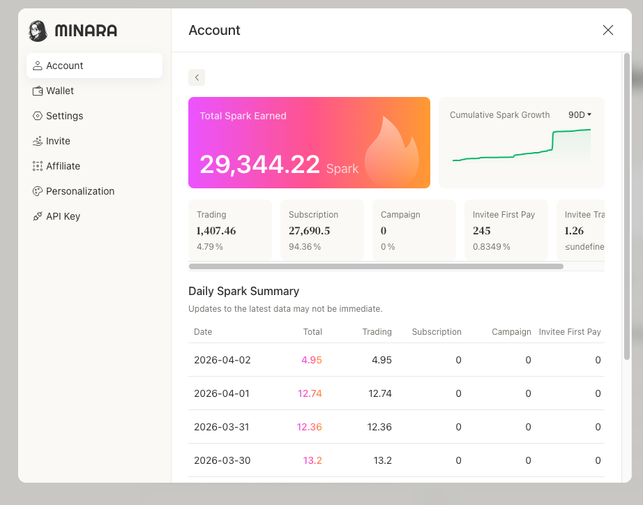

# What are Sparks?

**Sparks** are extra reward points you get by:

* Trading on Minara
* Subscribing to Minara
* Participating in Minara community campaigns
* [Referrals](referral-rewards.md) (you get Sparks from your invitees' trades and first subscription)

<figure><figcaption></figcaption></figure>

You can check your Sparks details in Setting - Account

\
They're different from **Credits.** Credits are used for running AI tasks, while Sparks are like special energy you can use for rewards and perks inside Minara.

You can use Sparks to unlock:

* Unique Discord badge & role
* NFT whitelist opportunities
* Official traffic boost for your high-quality posts
* Free entry to Minara's offline events
* Even exchange them for plan upgrades in the future

Sparks are our way to thank you for being an active explorer in the Minara ecosystem.

We'll keep adding new ways to use them soon!
